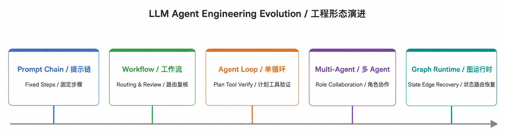
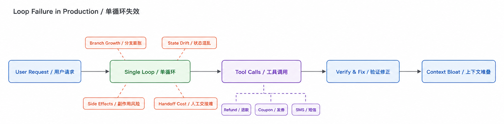
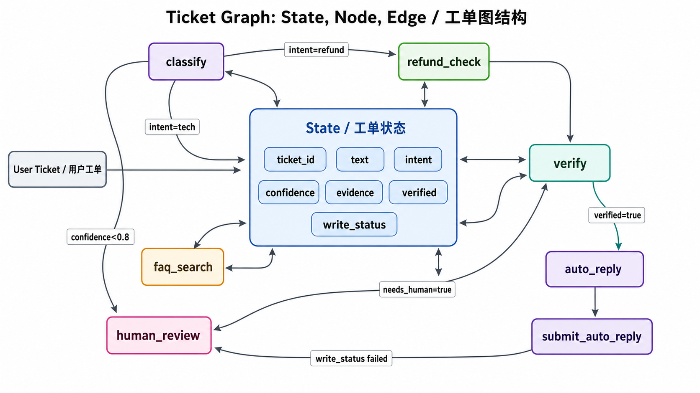
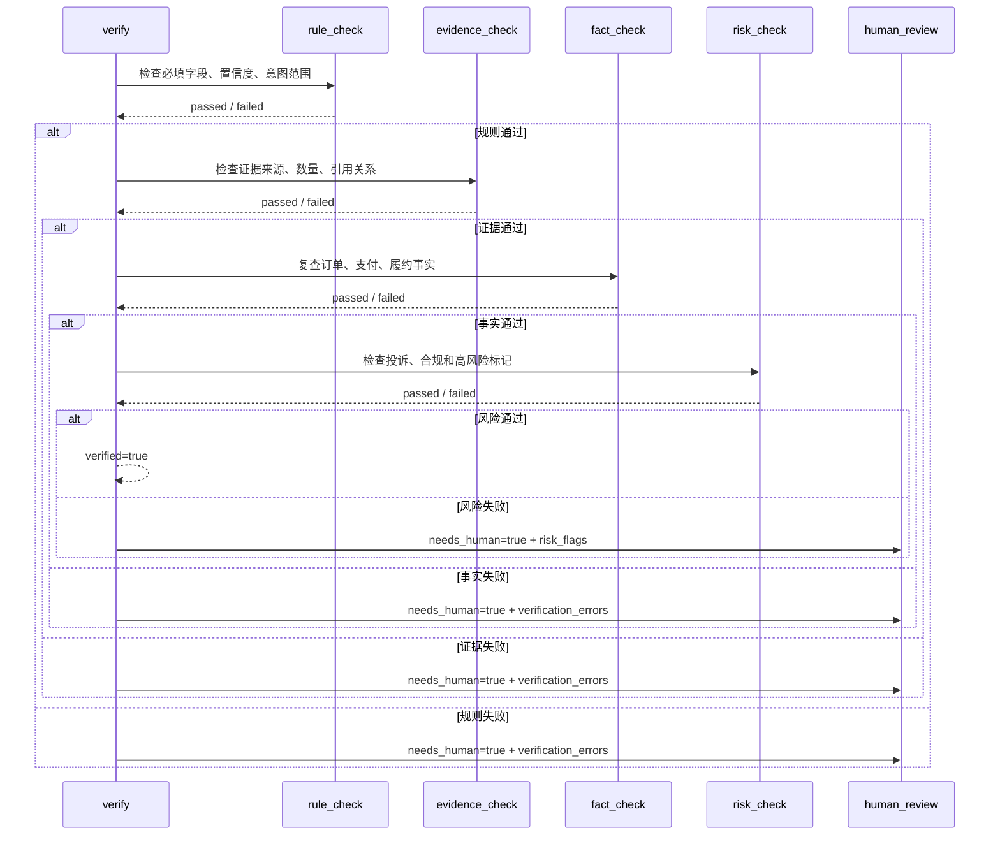
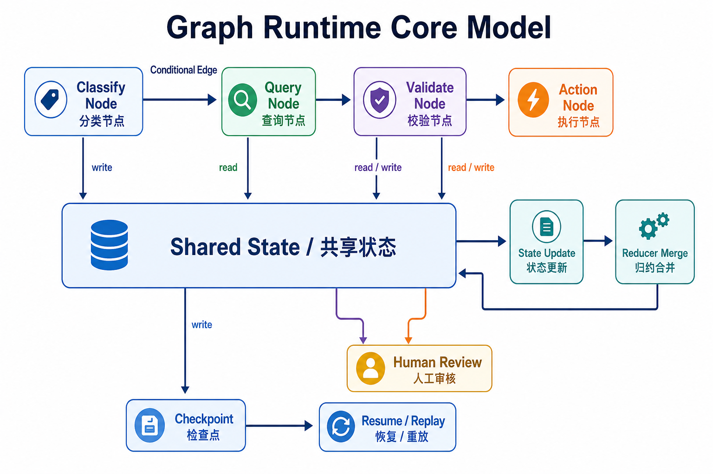
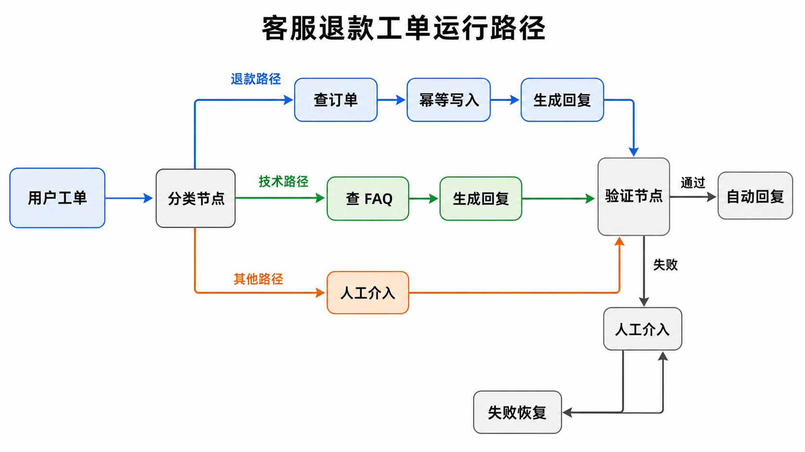
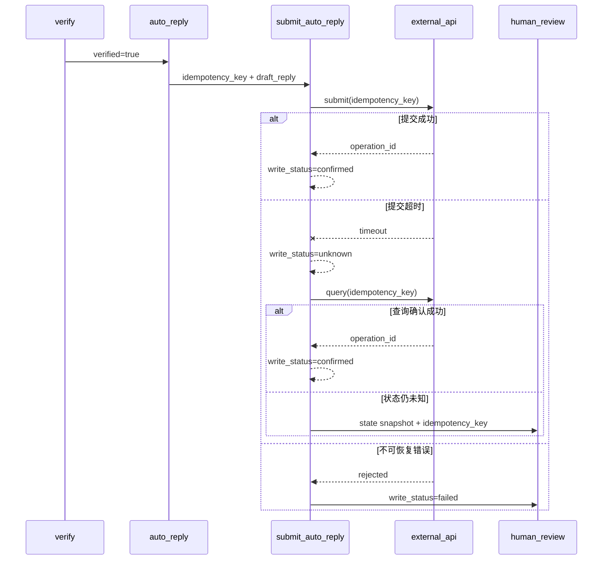

---
title: "Graph Engineering 架构"
date: 2026-07-27
categories: [AI]
tags: [Agent Engineering, Graph Engineering, Multi-Agent]
---

# Graph Engineering 架构

Agent 原型通常从一个很短的回路开始。模型读取用户输入，决定下一步动作，调用工具，检查结果，再决定是否修正。这类结构容易启动，也便于在 demo 阶段展示效果。

问题会在生产流程里集中出现。客服工单、销售跟进、订单审核、代码修复、数据分析这类任务都有相似特征：请求会分支，工具会失败，状态要跨步骤传递，外部系统有写入动作，部分结果需要人工处理。继续把这些职责压进一个循环，系统会越来越难调试，也越来越难稳定上线。

Graph Engineering 解决的是这类结构化编排问题。它用图结构组织 Agent 工作流，把节点职责、边路由、共享状态、验证位置、运行观测和恢复点显式表达出来。Loop 仍然有价值，但它更适合承担局部节点里的反复执行；当流程开始出现分支、并行、复核、恢复和人工处理时，外层需要 Graph 承担系统级编排。

## 1. 背景与问题来源

### 1.1 从 Prompt 到 Graph Runtime

LLM 应用的工程形态经历了几个阶段。最早的 prompt chain 解决固定步骤的文本处理问题，随后 workflow 把路由、并行和复核放进代码路径。工具调用普及后，Agent Loop 让模型可以根据环境反馈继续行动。多 Agent 架构继续把任务拆给不同角色、工具和上下文。进入生产流程后，系统需要进一步处理状态保存、失败恢复、人工介入和外部写入，因此 Graph Runtime 开始成为常见组织方式。



这条演进路径可以概括为下表。

| 阶段 | 主要做法 | 解决的问题 | 暴露的问题 |
|---|---|---|---|
| Prompt Chain | 多段 prompt 顺序串联 | 固定路径的摘要、改写、分类 | 分支和恢复能力弱 |
| Workflow | 代码定义流程和条件分支 | 业务流程稳定、路径可预测 | 模型自主调整空间有限 |
| Agent Loop | 模型计划、调用工具、检查结果、继续行动 | 开放任务和局部重试 | 状态、验证和副作用容易混在上下文里 |
| Multi-Agent | 多个角色或工具 Agent 协作 | 多视角任务拆解和专业能力复用 | 对话路径、共享状态和终止条件需要治理 |
| Graph Runtime | 节点、边、状态、检查点和人工路径 | 生产级运行、排障、恢复和审计 | 前期状态设计和观测建设成本更高 |

Anthropic 的 Agent 文章把 prompt chaining、routing、parallelization、orchestrator-workers、evaluator-optimizer 归纳为常见 workflow，并强调从简单模式开始。LangGraph 的 Graph API 进一步把 `State`、`Node`、`Edge` 和 reducer 变成运行时对象。Temporal 和 Airflow 这类系统也提供了可借鉴经验：长期运行的流程需要保存历史，批处理和调度流程需要显式依赖关系。Graph Engineering 吸收的是这些工程经验在 Agent 场景下的落地方式。

### 1.2 从 Prompt 到 Agent Loop

早期 LLM 应用常见形态是 prompt chain。工程上会把任务拆成几步，每一步把上一步输出拼进下一段 prompt。它适合固定路径，比如摘要、改写、分类、模板填充。

随着工具调用出现，Agent Loop 开始成为常见写法。它的基本过程如下：

```text
while not done:
    action = model.plan(messages, tool_specs)
    result = tool.execute(action)
    messages.append(action, result)
    done = model.check(messages)
```

这个循环的优点很明确：

- 路径短，业务接入成本低。
- 模型能根据工具结果继续调整动作。
- 失败后可以让模型重新尝试。
- demo 阶段只需要看一段上下文和工具日志。

Addy Osmani 在 Loop Engineering 文章里强调的也是这种局部回路：执行、验证、修正。这个观点适合放在节点内部使用。只要目标明确、反馈可靠、重试成本低，Loop 可以持续提升单点质量。

### 1.3 一个客服工单单循环示例

以客服工单为例，用户输入如下：

```text
我要退款，订单刚下单两天，还没有发货。
```

原型阶段可能会写成一个单循环：

```python
def ticket_agent_loop(user_text: str) -> str:
    messages = [
        {"role": "system", "content": "你是客服助手，可以查询订单、查询 FAQ、生成回复。"},
        {"role": "user", "content": user_text},
    ]

    for _ in range(4):
        action = llm_plan(messages)
        tool_result = run_tool(action)
        messages.append({"role": "tool", "content": tool_result})

        review = llm_review(messages)
        if review["done"]:
            return review["reply"]

        messages.append({"role": "assistant", "content": review["fix_instruction"]})

    return "已转人工处理"
```

这个版本可以跑通退款问题。模型发现用户想退款，调用订单工具，看到订单未发货且在退款窗口内，生成回复。短链路下，问题不明显。

生产客服系统会很快扩展出更多要求：

- 退款请求要查订单、支付、履约、活动规则。
- 技术问题要查 FAQ、设备信息、最近故障公告。
- 投诉和高风险内容要直接进入人工处理。
- 自动回复前要确认引用证据和话术合规。
- 修改订单、发券、发短信这类写操作要有幂等处理。
- 人工处理时要拿到结构化状态，而不是一整段对话。

此时单循环仍然能继续堆逻辑，但每次新增分支都会把状态、验证和副作用继续塞进同一段上下文。

### 1.4 单循环进入生产后的五类瓶颈



第一类瓶颈是分支增多。退款、技术、投诉、售后、活动咨询对应不同工具和规则。单循环把分支藏在模型的下一步动作里，代码层很难直接看出一条请求会经过哪些步骤。

第二类瓶颈是状态膨胀。所有工具结果、模型判断、修正说明都追加到上下文，后续判断会被大量历史信息干扰。更麻烦的是，哪些字段可以覆盖、哪些字段必须追加、哪些字段只用于调试，循环本身没有稳定表达。

第三类瓶颈是验证不独立。让生成回复的模型同时判断回复是否可靠，容易把错误包进同一个推理过程。生产系统更需要用规则、测试结果、外部事实或专用验证节点做放行判断。

第四类瓶颈是副作用难回滚。发券、改订单、发短信、写审批结果一旦发生，重试就可能造成重复写入。循环如果没有明确的提交点和幂等键，失败恢复会变成业务事故来源。

第五类瓶颈是人工交接困难。人工客服需要看到意图、证据、风险、已调用工具、失败原因和建议动作。单循环通常只能给出长上下文，接手成本高，审计也不稳定。

这些问题共同指向同一个工程结论：生产级 Agent 需要把控制流和状态流从上下文里拿出来，放到可观测、可恢复、可测试的结构里。

## 2. Loop Engineering 的能力边界

### 2.1 单循环的基本结构

Loop Engineering 关注一轮局部执行如何变得更稳。它通常包含四个环节：

- 计划：模型决定下一步动作。
- 执行：调用工具、代码、检索或外部 API。
- 验证：检查结果是否满足目标。
- 修正：失败后调整策略并重试。

这个结构适合把一个节点内部的能力打磨好。例如代码修复节点可以循环运行测试、读取失败日志、修改补丁；检索节点可以循环扩展关键词、重排结果、补齐引用；数据分析节点可以循环执行 SQL、检查空值、修正查询。

### 2.2 适合场景

Loop 更适合以下任务：

- 目标明确，成功标准清晰。
- 工具集合小，路径短。
- 重试成本低，没有高风险写操作。
- 验证信号可靠，比如测试通过、SQL 执行成功、格式校验通过。
- 人工只关心最终结果，不需要介入中间状态。

在这些场景里，Graph 可能会带来不必要的结构成本。一个函数或一个节点里的循环就能完成任务。

### 2.3 分支状态副作用和验证带来的局限

当任务开始跨越多个业务步骤，Loop 的问题会从提示词质量扩展到系统结构表达。

| 现象 | 直接问题 | 根因 | 适合的处理方式 |
|---|---|---|---|
| 分支越来越多 | 下一步路径难预测 | 路由逻辑藏在模型上下文里 | 用条件边表达分支 |
| 上下文越来越厚 | 判断质量下降，调试困难 | 状态没有结构化字段和合并规则 | 定义共享状态和 reducer |
| 验证结果不稳定 | 错误回复被放行 | 生成和验证混在同一回路 | 独立验证节点接规则或事实 |
| 外部写入失败 | 重试可能重复发券或写订单 | 提交点和幂等键缺失 | 写操作放到验证之后 |
| 人工接管困难 | 处理人员需要重读上下文 | 交接信息没有结构化快照 | 人工节点接收状态摘要 |

Loop 和 Graph 的关系可以这样理解：Loop 负责局部能力的反复执行，Graph 负责把多个局部能力组织成完整流程。前者提高单点质量，后者提高系统可控性。

## 3. Graph Engineering 的核心模型

### 3.1 概念边界与工程来源

Graph Engineering 可以定义为：用图结构组织 Agent 工作流的工程方法。它来自多类工程经验，但关注点落在 Agent 运行时。为了避免概念泛化，需要先区分几类相近系统。

| 类型 | 核心对象 | 状态来源 | 路由方式 | 适用场景 | 对 Agent 的启发 |
|---|---|---|---|---|---|
| Workflow | 步骤和业务对象 | 业务系统或临时变量 | 代码条件分支 | 审批、批处理、固定业务流程 | 复杂流程应显式表达 |
| DAG | 任务和依赖边 | 任务产物和调度上下文 | 依赖关系决定顺序 | ETL、离线任务、周期调度 | 可观测的依赖关系便于排障 |
| 状态机 | 状态和事件 | 当前状态与事件输入 | 事件触发状态迁移 | 订单、审批、设备控制 | 状态转移应有可解释依据 |
| Temporal 类持久工作流 | Workflow、Activity、事件历史 | 持久化历史和活动结果 | 代码路径与重试策略 | 长流程、可靠任务、失败恢复 | 长任务需要持久化历史和外部活动隔离 |
| Graph Engineering | State、Node、Edge、reducer | 图运行中的共享状态 | 条件边、并行边、人工路径 | 多分支、多工具、需审计的 Agent 流程 | Agent 行动需要和状态、恢复、验证绑定 |

这些系统有共同点：都把流程从一段上下文或一段脚本里拆出来，让路径和状态可见。Graph Engineering 的特殊之处在于节点里可能包含 LLM、检索、工具调用和子 Agent，因此状态设计、验证策略、人工介入和外部写入需要同时考虑。

### 3.2 节点边和状态

Graph Engineering 的核心，是把一次运行拆成三类对象：状态、节点、边。

| 对象 | 作用 | 关注点 |
|---|---|---|
| State | 保存当前运行中可共享的事实 | 哪些字段需要跨节点传递 |
| Node | 读取 State，产出局部增量 | 节点只处理自己的职责 |
| Edge | 根据状态决定下一跳 | 路由条件是否能被解释 |

State 记录事实和控制信息，Node 处理局部任务，Edge 只负责路由。三者分开以后，系统才有机会把“谁改了什么、走这条路的依据、失败后从哪恢复”说清楚。

在上述提到的客服工单场景里，这三者可以一一对应：

| 对象 | 在工单里的含义 | 例子 |
|---|---|---|
| State | 这一单当前已经知道什么 | `run_id`、`ticket_id`、`text`、`evidence`、`verified`、`write_status` |
| Node | 某一步具体做什么 | 分类、补证、验证、写回复、人工接管 |
| Edge | 下一步去哪里 | 退款、技术、人工、自动回复 |



一条典型工单路径可以拆成这样：

1. 用户提交文本后，`State` 里先保存 `ticket_id` 和原始内容。
2. `classify` 节点读取 `text`，写入 `intent` 和 `confidence`。
3. `Edge` 根据 `intent` 把请求送到 `refund_check`、`faq_search` 或 `human_review`。
4. `refund_check` 或 `faq_search` 继续往 `State` 里追加 `evidence`。
5. `verify` 节点读取 `evidence` 和 `confidence`，写入 `verified`、`needs_human`、`risk_flags`。
6. `Edge` 再根据 `verified` 决定走 `auto_reply` 还是 `human_review`。
7. `auto_reply` 先准备 `idempotency_key`，`submit_auto_reply` 再写入 `write_status` 和 `external_operation_id`。

注意，边的判断条件也要落到对应的字段上：

| 所在位置 | 判断字段 | 下一跳 |
|---|---|---|
| `classify` 之后 | `confidence < 0.8` | `human_review` |
| `classify` 之后 | `intent = refund` | `refund_check` |
| `classify` 之后 | `intent = tech` | `faq_search` |
| `verify` 之后 | `needs_human = true` | `human_review` |
| `verify` 之后 | `verified = true` | `auto_reply` |
| `submit_auto_reply` 之后 | `write_status = confirmed` | 结束 |
| `submit_auto_reply` 之后 | `write_status = unknown / failed` | `human_review` |

对于节点职责继续拆分：

- `classify` 只判断意图和置信度。
- `refund_check` 只补订单和支付证据。
- `faq_search` 只补技术问题证据。
- `verify` 只判断是否能够放行。
- `auto_reply` 只准备回复提交参数。
- `submit_auto_reply` 只执行外部写入。
- `human_review` 只接管例外路径。

节点设计要看职责边界，不看自然语言步骤。一个节点如果同时承担分类、补证、写回复和提交动作，后面再加恢复和人工介入就会很难收。更稳的做法是让每个节点只对少量字段负责，让边去决定下一跳。

### 3.3 状态更新与 reducer

状态设计决定图能不能稳定运行。状态字段最好分成四类：

| 字段类型 | 示例 | 更新方式 | 作用 |
|---|---|---|---|
| 路由字段 | `intent`、`confidence`、`route_reason` | 覆盖 | 决定下一跳 |
| 证据字段 | `evidence`、`risk_flags`、`verification_errors` | 追加 | 保存跨节点共享事实 |
| 控制字段 | `verified`、`needs_human`、`write_status` | 覆盖 | 表示流程位置 |
| 写入字段 | `idempotency_key`、`external_operation_id` | 稳定写入 | 关联外部动作 |

追加型字段适合保存多条证据、错误原因和风险标记。覆盖型字段适合保存意图判断、人工分流和提交状态。只读字段不应该被后续节点反向改写。

reducer 的作用是定义字段合并规则。它关注状态更新的语义，不承载业务判断。常见情况有三种：

- 追加：证据、错误、风险标记逐条累加。
- 覆盖：意图、置信度、是否需要人工由后续节点更新。
- 保持：提交后的外部标识尽量稳定，不被后续节点随意改写。

如果字段语义不清，节点就会开始互相覆盖状态，图会变成一段松散的上下文传递。字段过少会逼迫节点偷读上下文，字段过多会把运行结果拖成大对象。比较稳的做法是只保留跨节点确实需要的事实，把临时推理留在节点内部。

放回客服工单里看，reducer 最常见的作用有三种：

- `evidence` 可以从 `refund_check`、`faq_search`、后续事实校验节点逐条追加。
- `verification_errors` 可以从规则校验、事实校验、风险校验阶段逐条累加。
- `write_status` 通常只覆盖，不追加，因为提交结果只需要保留最终态。

### 3.4 验证节点的内部结构

验证节点承担放行判断。它需要把生成结果、证据、风险和外部事实分开处理，避免让同一个模型同时生成回复和放行回复。

常见现象、问题和处理方式如下。

| 现象 | 问题 | 原因 | 方案 | 注意事项 |
|---|---|---|---|---|
| 回复引用了订单状态 | 引用事实可能过期 | 订单工具和回复生成之间存在时间差 | 验证时重新检查关键字段或比对版本 | 高风险写操作前再读一次外部事实 |
| 证据数量足够但质量差 | 自动回复可能误导用户 | 证据没有来源、时间和字段边界 | 证据结构化保存来源、时间和摘要 | 只用跨节点需要的事实进入 State |
| 用户内容命中投诉风险 | 自动化路径继续推进 | 风险判断依赖生成模型自检 | 单独执行规则或分类节点 | 命中风险后进入人工处理 |
| 规则判断和 LLM 复核冲突 | 放行结果不稳定 | 验证策略没有优先级 | 规则、事实、合规优先，LLM 复核只做辅助 | 失败原因需要写入状态 |
| 外部写入即将发生 | 重试可能重复提交 | 幂等键没有稳定来源 | 写入前生成稳定幂等键 | 幂等键不应依赖随机 checkpoint |

验证节点可以按四层组织：

- 规则校验：检查必填字段、置信度、意图范围、回复长度和格式。
- 证据校验：检查证据来源、数量、时间、关键字段和引用关系。
- 事实校验：对订单、支付、履约等关键事实执行必要的二次查询。
- 风险校验：检查投诉、合规、敏感内容、金额风险和人工处理规则。

LLM 复核可以作为补充，用于检查话术是否自然、解释是否完整、证据是否被正确引用。它不适合作为唯一放行条件。

验证节点的时序可以表示为：



### 3.5 条件路由并行恢复和人工介入



Graph Runtime 的执行过程可以拆成七步：

1. 接收输入，初始化 `State`。
2. 调度入口节点。
3. 节点读取状态，返回局部增量。
4. reducer 合并增量，生成新的状态快照。
5. 条件边根据状态选择下一跳。
6. 关键节点前后写入 checkpoint。
7. 验证失败、风险升高或工具异常时，把状态快照交给人工处理。

这套模型的重点是状态转移可见。每个节点改了哪些字段、条件边依据哪些字段选择下一跳、失败后从哪个 checkpoint 恢复，都可以被记录下来。

并行场景也适合用图表达。比如技术工单可以同时查 FAQ、故障公告和用户设备信息，然后在一个汇合节点合并证据。Loop 也能通过 prompt 描述并行需求，但运行时很难稳定记录每个分支的输入、输出、耗时和错误。

人工介入需要作为正常路径设计。高风险投诉、证据不足、验证失败、外部写入异常，都应该能进入人工节点。人工节点拿到的内容应包括状态快照、已调用工具、关键证据、失败原因和建议动作。LangGraph 的 interrupt 能力也体现了类似思想：运行可以暂停，等待人工输入后继续。

## 4. 工程案例实战

### 4.1 客服退款工单路由



这个案例处理一个最小生产流程：

1. 用户提交工单文本。
2. `classify` 判断意图。
3. 退款问题进入 `refund_check`，技术问题进入 `faq_search`，其他问题进入 `human_review`。
4. 证据补齐后进入 `verify`。
5. 验证通过后进入 `auto_reply` 准备写入参数。
6. `submit_auto_reply` 执行外部系统提交。
7. 证据不足、置信度低、风险命中或写入异常时进入 `human_review`。

这张图表达了三个关键点：

- 业务分支由条件边决定，不藏在一段 prompt 里。
- 验证节点独立于生成节点，便于接规则、事实和审计。
- 自动回复是提交动作，需要稳定幂等键，失败后可以从 checkpoint 恢复。

### 4.2 LangGraph 实现

下面的代码保留了生产系统最容易出问题的几个点：状态增量、条件边、验证节点、人工出口、checkpoint、幂等键和外部写入状态。代码是教学骨架，生产环境还需要持久化 checkpointer、稳定日志、外部系统状态查询和更完整的异常分类。

```python
from typing import Annotated, Literal, TypedDict
import operator

from langgraph.checkpoint.memory import InMemorySaver
from langgraph.graph import END, START, StateGraph


WriteStatus = Literal["pending", "confirmed", "unknown", "failed"]


# 图运行期间共享的最小状态。字段按路由、证据、控制和写入分组。
class TicketState(TypedDict, total=False):
    # 运行标识和用户输入。
    run_id: str
    ticket_id: str
    text: str

    # 路由字段，由 classify 节点写入。
    intent: Literal["refund", "tech", "other"]
    confidence: float
    route_reason: str

    # 证据和草稿回复，由查询类节点补充。
    evidence: Annotated[list[str], operator.add]
    draft_reply: str

    # 验证和人工处理字段，由 verify 或写操作节点更新。
    verified: bool
    needs_human: bool
    risk_flags: Annotated[list[str], operator.add]
    verification_errors: Annotated[list[str], operator.add]

    # 外部写操作字段，幂等键生成后应保持稳定。
    idempotency_key: str
    write_status: WriteStatus
    external_operation_id: str


def classify(state: TicketState) -> TicketState:
    # 分类节点只负责产出意图、置信度和路由原因。
    text = state["text"]
    if "退款" in text:
        return {
            "intent": "refund",
            "confidence": 0.92,
            "route_reason": "命中退款诉求",
        }
    if any(keyword in text for keyword in ["报错", "打不开", "登录失败"]):
        return {
            "intent": "tech",
            "confidence": 0.86,
            "route_reason": "命中技术问题",
        }
    return {
        "intent": "other",
        "confidence": 0.54,
        "route_reason": "未命中自动化路径",
    }


def route_from_classify(state: TicketState) -> str:
    # 低置信度请求直接进入人工处理。
    if state["confidence"] < 0.8:
        return "human_review"
    return {
        "refund": "refund_check",
        "tech": "faq_search",
        "other": "human_review",
    }[state["intent"]]


def refund_check(state: TicketState) -> TicketState:
    # 真实系统里这里应查询订单、支付、履约和售后规则。
    return {
        "evidence": ["订单在退款窗口内", "订单未发货", "支付状态为已支付"],
        "draft_reply": "你的订单符合退款条件，可以在订单详情页发起退款。",
    }


def faq_search(state: TicketState) -> TicketState:
    # 技术问题路径只补充 FAQ 和故障公告证据。
    return {
        "evidence": ["FAQ 建议先清理缓存后重试", "最近无登录故障公告"],
        "draft_reply": "请先清理缓存后重试，如仍失败可以补充截图。",
    }


def verify(state: TicketState) -> TicketState:
    # 验证节点集中处理规则、证据、风险和回复完整性。
    errors: list[str] = []
    risk_flags: list[str] = []

    if state.get("confidence", 0) < 0.8:
        errors.append("意图置信度低于自动处理阈值")
    if len(state.get("evidence", [])) < 2:
        errors.append("可引用证据不足")
    if any(keyword in state["text"] for keyword in ["投诉", "曝光", "律师"]):
        risk_flags.append("命中投诉或合规风险")
    if not state.get("draft_reply"):
        errors.append("缺少待发送回复")

    verified = not errors and not risk_flags
    return {
        "verified": verified,
        "needs_human": not verified,
        "verification_errors": errors,
        "risk_flags": risk_flags,
    }


def route_from_verify(state: TicketState) -> str:
    # 验证失败或命中风险后进入人工处理。
    return "human_review" if state.get("needs_human") else "auto_reply"


def auto_reply(state: TicketState) -> TicketState:
    # 这里只准备外部写入参数，不直接提交客服系统。
    ticket_id = state["ticket_id"]
    run_id = state["run_id"]
    return {
        "idempotency_key": f"ticket:{ticket_id}:run:{run_id}:auto_reply",
        "write_status": "pending",
    }


def submit_ticket_reply(
    ticket_id: str,
    reply: str,
    idempotency_key: str,
) -> dict[str, str]:
    # 示例里直接返回成功结果。真实系统应调用客服工单 API。
    return {
        "operation_id": f"reply_{ticket_id}_{idempotency_key[-10:]}",
        "status": "confirmed",
    }


def submit_auto_reply(state: TicketState) -> TicketState:
    # 写操作独立成节点，便于记录提交状态和失败原因。
    try:
        result = submit_ticket_reply(
            ticket_id=state["ticket_id"],
            reply=state["draft_reply"],
            idempotency_key=state["idempotency_key"],
        )
        return {
            "write_status": "confirmed",
            "external_operation_id": result["operation_id"],
        }
    except TimeoutError:
        return {
            "write_status": "unknown",
            "needs_human": True,
            "verification_errors": ["自动回复提交超时，需要按幂等键查询外部系统状态"],
        }
    except Exception as exc:
        return {
            "write_status": "failed",
            "needs_human": True,
            "verification_errors": [f"自动回复提交失败：{type(exc).__name__}"],
        }


def route_from_submit(state: TicketState) -> str:
    # 写入状态未知或失败时，由人工继续确认。
    return "human_review" if state.get("needs_human") else END


def human_review(state: TicketState) -> TicketState:
    # 人工节点接收结构化原因，避免处理人员重读完整上下文。
    reasons = state.get("verification_errors", []) or [state.get("route_reason", "需要人工判断")]
    return {
        "needs_human": True,
        "draft_reply": f"已转人工处理。当前原因：{'；'.join(reasons)}",
    }


workflow = StateGraph(TicketState)
workflow.add_node("classify", classify)
workflow.add_node("refund_check", refund_check)
workflow.add_node("faq_search", faq_search)
workflow.add_node("verify", verify)
workflow.add_node("auto_reply", auto_reply)
workflow.add_node("submit_auto_reply", submit_auto_reply)
workflow.add_node("human_review", human_review)

workflow.add_edge(START, "classify")
workflow.add_conditional_edges("classify", route_from_classify)
workflow.add_edge("refund_check", "verify")
workflow.add_edge("faq_search", "verify")
workflow.add_conditional_edges("verify", route_from_verify)
workflow.add_edge("auto_reply", "submit_auto_reply")
workflow.add_conditional_edges("submit_auto_reply", route_from_submit)
workflow.add_edge("human_review", END)

# 示例 checkpointer。生产环境应替换成数据库或其他持久化存储。
checkpointer = InMemorySaver()
app = workflow.compile(checkpointer=checkpointer)

result = app.invoke(
    {
        "run_id": "R202607240001",
        "ticket_id": "T10086",
        "text": "我要退款，订单刚下单两天，还没有发货。",
    },
    config={"configurable": {"thread_id": "ticket:T10086"}},
)
```

这段代码的工程重点如下：

- 节点只返回自己负责的状态增量。
- `route_from_classify`、`route_from_verify` 和 `route_from_submit` 明确表达分支。
- `verify` 返回结构化验证结果，不只看证据数量和置信度。
- `auto_reply` 用稳定业务字段生成幂等键，避免重试时改变写入标识。
- `submit_auto_reply` 单独表达外部写操作，便于记录提交状态和异常。
- `InMemorySaver` 用于演示 checkpoint；生产环境应替换成持久化存储。

### 4.3 一次运行的 state diff 与失败路径

退款请求的正常路径如下：

```text
START
  -> classify
  -> refund_check
  -> verify
  -> auto_reply
  -> submit_auto_reply
  -> END
```

对应的状态变化如下：

```text
01 classify
+ intent="refund"
+ confidence=0.92
+ route_reason="命中退款诉求"

02 refund_check
+ evidence=["订单在退款窗口内", "订单未发货", "支付状态为已支付"]
+ draft_reply="你的订单符合退款条件，可以在订单详情页发起退款。"

03 verify
+ verified=true
+ needs_human=false

04 auto_reply
+ idempotency_key="ticket:T10086:run:R202607240001:auto_reply"
+ write_status="pending"

05 submit_auto_reply
+ write_status="confirmed"
+ external_operation_id="reply_T10086_auto_reply"
```

失败路径也要显式：

```text
START
  -> classify
  -> refund_check
  -> verify
  -> human_review
  -> END
```

进入人工处理的常见原因如下：

- `confidence < 0.8`，意图不稳定。
- `evidence` 少于两条，证据不足。
- 订单状态、支付状态或履约状态查询失败。
- 用户内容命中投诉、合规或高风险规则。
- 自动回复提交失败，且重试次数达到上限。
- 自动回复提交超时，外部系统状态无法立即确认。

排障时不需要重读完整上下文，可以直接看三个信息：路径、状态差异、失败节点。这样才能定位是分类错、证据不足、验证规则过严，还是外部系统调用失败。

### 4.4 写操作失败与恢复路径

外部写操作是生产 Agent 最容易出事故的位置。退款、发券、发短信、自动回复、审批写入都可能在网络超时后处于未知状态。此时直接重试会带来重复提交风险，直接失败又可能丢掉已经成功的操作。

处理顺序建议如下：

1. 验证通过后生成稳定幂等键。
2. 提交外部系统时携带幂等键。
3. 成功返回后记录 `external_operation_id` 和 `write_status="confirmed"`。
4. 超时后记录 `write_status="unknown"`，按幂等键查询外部系统状态。
5. 查询仍然无法确认时进入人工处理。
6. 不可恢复错误记录 `write_status="failed"`，同时保留状态快照。

对应时序如下：



这里的关键点是把写操作从回复生成里拆出来。`auto_reply` 只准备写入参数，`submit_auto_reply` 才执行外部提交。这样失败、查询、恢复和人工处理都有稳定位置。

## 5. Graph Engineering 与 Multi-Agent 架构对比

### 5.1 历史背景和能力来源

Multi-Agent 架构的起点通常是把复杂任务拆给多个具备不同角色、工具或记忆的 Agent。CAMEL 强调 role-playing 方式下的协作对话，AutoGen 把多个可对话 Agent 组织成应用框架，MetaGPT 把软件团队里的 SOP 引入多 Agent 协作，Magentic-One 采用 Orchestrator 统筹任务推进、进度跟踪和重规划。

这些工作解决了一个关键问题：当任务需要不同专家视角时，单个模型上下文很难同时稳定承担规划、执行、复核和沟通。多 Agent 能把职责拆开，让 Planner、Researcher、Coder、Reviewer、Operator 这类角色围绕同一个目标协作。

进入生产流程后，问题会继续往运行时下沉。多个 Agent 之间谁先执行、共享哪些状态、失败后从哪里恢复、人工在哪一步介入、外部写操作如何避免重复提交，这些问题不能只靠角色设定解决。Graph Engineering 关注的正是这些运行时结构。

### 5.2 关注点差异

| 架构 | 核心组织方式 | 控制流 | 状态管理 | 验证恢复 | 适用场景 | 生产风险 |
|---|---|---|---|---|---|---|
| CAMEL 类角色协作 | 通过角色设定驱动对话 | 由对话轮次推进 | 主要依赖对话上下文 | 依赖角色互评和外部约束 | 研究模拟、任务拆解、协作探索 | 对话发散后路径难复现 |
| AutoGen 类多 Agent 对话 | 多个可对话 Agent 互相调用 | 会话编排和消息路由 | 会话历史和局部记忆 | 可接人工和工具结果 | 需要多角色协作的原型系统 | 状态边界和终止条件需要额外治理 |
| MetaGPT 类 SOP 协作 | 角色按流程产出中间工件 | SOP 驱动的阶段流转 | 文档和中间产物承载状态 | 通过阶段评审降低偏差 | 软件工程类分工协作 | SOP 之外的异常路径处理成本高 |
| Magentic-One 类 Orchestrator | 调度器分配任务并跟踪进度 | Orchestrator 规划和重规划 | 任务记录、工具结果和上下文 | 通过调度器调整路径 | 开放任务、多工具操作、跨系统任务 | 调度器失误会影响全局路径 |
| Graph Engineering | 节点、条件边和共享状态 | 图结构显式表达下一跳 | State、StateDelta 和 reducer | checkpoint、独立验证和人工节点 | 多分支、多工具、需审计的生产流程 | 前期状态设计和观测建设成本更高 |

重点可以概括为三点：

- Multi-Agent 更关注角色、协作方式和对话拓扑。
- Graph Engineering 更关注运行时控制流、共享状态、条件路由、恢复和观测。
- 两者可以组合使用：一个 Agent 可以是图里的节点，一组 Agent 可以封装成子图，外层仍由 Graph 管理分支、状态和恢复。

### 5.3 在客服工单里的落地关系

客服退款工单如果只做自动回复，Graph 已经能覆盖主要工程问题。`classify`、`refund_check`、`verify`、`auto_reply`、`submit_auto_reply`、`human_review` 这些节点足够表达分支、证据、验证、写入和人工处理。

当场景扩展到跨团队协作时，可以引入 Multi-Agent。例如：

- 售后 Agent 负责退款政策和订单证据。
- 技术 Agent 负责故障公告、设备信息和 FAQ。
- 合规 Agent 负责敏感内容、投诉升级和话术风险。
- 人工协作 Agent 负责整理交接摘要和建议动作。

这些 Agent 不宜直接通过长对话自由串联。更稳的落地方式是把它们挂到图节点或子图里：

1. `classify` 节点决定进入退款、技术、投诉或人工路径。
2. 路径内部可以调用一个或多个专业 Agent 产出证据。
3. `verify` 节点统一检查证据、风险和回复条件。
4. 外部写操作只在验证通过后执行。
5. 失败、低置信度或高风险内容进入 `human_review`。

这样组织后，Multi-Agent 提供专业能力，Graph 提供生产运行结构。系统既能保留多角色协作的表达力，也能保留路径、状态、恢复和审计能力。

## 6. 技术选型与最佳实践

### 6.1 Loop Workflow Graph Agent 对比

| 模式 | 控制流 | 状态管理 | 验证方式 | 可观测性 | 适用场景 | 成本 |
|---|---|---|---|---|---|---|
| Prompt Chain | 固定顺序 | 上下文串联 | 格式或简单规则 | 低 | 摘要、改写、分类 | 低 |
| Loop Engineering | 执行、验证、修正循环 | 同一上下文为主 | 自检或外部测试 | 中 | 代码修复、检索增强、局部任务 | 中 |
| Workflow | 代码定义固定流程 | 业务对象或临时状态 | 规则和任务结果 | 中 | 固定审批、批处理、ETL | 中 |
| Graph Engineering | 节点、条件边、并行、恢复 | 显式 State 和 reducer | 独立验证节点和外部事实 | 高 | 多分支、多工具、需审计的 Agent 流程 | 中高 |
| Autonomous Agent | 模型动态规划路径 | 长上下文和记忆 | 模型自评加少量规则 | 不稳定 | 开放探索、研究型任务 | 高 |

重点结论：

- 固定短链路优先用 Prompt Chain 或 Workflow。
- 单点能力需要反复尝试时使用 Loop。
- 多分支、多工具、可恢复、需人工处理的流程使用 Graph。
- 开放目标可以使用 Autonomous Agent，但生产写操作要谨慎限制。

### 6.2 上线检查与排障路径

上线前至少确认这些工程问题：

- 每个节点是否只有一个主要职责。
- 每条条件边是否能从状态字段解释。
- 状态字段是否区分追加、覆盖和只读。
- 验证节点是否独立于生成节点。
- 外部写操作是否在验证之后执行。
- 外部写操作是否有稳定幂等键。
- checkpoint 是否能恢复到关键节点前后。
- 人工处理是否能拿到结构化状态快照。
- 日志是否包含 `run_id`、`node_id`、`state_diff`、`tool_calls`、`latency`、`cost`、`error_type`。
- 测试是否覆盖正常路径、低置信度路径、证据不足路径、工具失败路径和重复提交路径。

Graph 系统的排障顺序建议如下：

1. 先看 `run_id` 对应的完整路径，确认请求走过哪些节点。
2. 再看每个节点的 `state_diff`，确认字段变化是否符合预期。
3. 检查条件边的输入字段和路由结果。
4. 检查工具调用结果、耗时和错误类型。
5. 检查验证节点的依据，区分证据不足和规则过严。
6. 检查 checkpoint 是否落在恢复所需的位置。
7. 检查幂等键是否覆盖所有外部写操作。

### 6.3 评测体系与自动化评测

Graph 上线后，最容易被误判的是“最终回复看起来正确”。在上述客服工单里，一次回复可能写得通顺，但中间路径已经走错：退款请求走到了技术路径，证据没有补齐就进入自动回复，外部写入失败后没有进入恢复路径，或者重复提交用了不同的幂等键。

这类问题需要按运行结构评测。调研现有 agent 评测和 graph 评测方法后，可以归纳出几个共识：先保存完整运行轨迹，再把轨迹拆成最终输出、路径、中间状态、单步节点和工具调用；确定性问题优先用代码断言，开放性问题再接模型评测和人工抽检；线上失败样本要持续回灌到评测集。落到 Graph Engineering 里，评测对象可以拆成下面几层。

| 层级 | 评测对象 | 需要判断的问题 | 自动化方式 |
|---|---|---|---|
| 节点评测 | 单个节点 | 节点是否只改自己负责的字段 | 输入 state，断言 state delta |
| 边评测 | 条件边 | 路由是否符合字段条件 | 构造 state，断言下一跳 |
| 状态评测 | 状态更新 | 追加、覆盖、稳定写入是否正确 | 对比 final state 和 state diff |
| 路径评测 | 完整路径 | 请求是否走过预期节点 | 对比实际 path 和 expected path |
| 恢复评测 | 失败路径 | 工具超时、未知写入、重复提交是否可控 | 注入工具异常，断言 checkpoint、幂等键和人工路径 |
| 输出评测 | 最终结果 | 回复是否基于证据且话术合规 | 规则评测加模型评测 |

客服工单的评测用例建议用结构化数据保存。每条用例至少包含四部分：输入、期望路径、关键状态、写操作预期。

```json
{
  "case_id": "refund_success_001",
  "input": {
    "ticket_id": "T10086",
    "text": "我要退款，订单刚下单两天，还没有发货。"
  },
  "expected_path": [
    "classify",
    "refund_check",
    "verify",
    "auto_reply",
    "submit_auto_reply"
  ],
  "expected_state": {
    "intent": "refund",
    "verified": true,
    "needs_human": false,
    "write_status": "confirmed"
  },
  "expected_writes": [
    {
      "operation": "submit_reply",
      "idempotent": true
    }
  ]
}
```

为了让这些用例可以自动执行，Graph 运行时也要输出结构化记录。最小记录如下：

```json
{
  "run_id": "run_001",
  "path": ["classify", "refund_check", "verify", "auto_reply"],
  "state_diffs": [
    {
      "node": "classify",
      "diff": {
        "intent": "refund",
        "confidence": 0.92
      }
    }
  ],
  "tool_calls": [
    {
      "node": "submit_auto_reply",
      "tool": "submit_reply",
      "idempotency_key": "ticket:T10086:auto_reply:ckpt_xxx",
      "status": "confirmed"
    }
  ],
  "final_state": {
    "verified": true,
    "write_status": "confirmed"
  }
}
```

自动化评测先从确定性规则开始。路径、状态、工具调用、幂等键都适合用代码断言。最终回复的语气、解释质量和证据引用，可以再接模型评测或人工抽检。

```python
def assert_path(actual: dict, expected: dict) -> None:
    assert actual["path"] == expected["expected_path"]


def assert_state(actual: dict, expected: dict) -> None:
    for key, value in expected["expected_state"].items():
        assert actual["final_state"].get(key) == value


def assert_idempotent_writes(actual: dict) -> None:
    writes = [
        call for call in actual["tool_calls"]
        if call["tool"] == "submit_reply"
    ]
    keys = [call["idempotency_key"] for call in writes]
    assert len(keys) == len(set(keys))


def assert_no_write_before_verify(actual: dict) -> None:
    verify_index = actual["path"].index("verify")
    for call in actual["tool_calls"]:
        write_index = actual["path"].index(call["node"])
        assert write_index > verify_index
```

评测集来源建议覆盖四类：

- 线上真实工单抽样，覆盖高频退款、技术、售后和投诉场景。
- 历史失败案例，覆盖误分类、证据不足、工具超时、重复提交。
- 人工构造边界输入，覆盖低置信度、混合意图、缺少订单号、高风险话术。
- 影子运行结果，把新图或新模型旁路运行后产生的差异回灌成新用例。

自动化执行可以分三档。

| 评测方式 | 触发时机 | 目标 |
|---|---|---|
| 快速回归 | 改 prompt、节点、边、状态字段时 | 防止确定性路径和状态更新被破坏 |
| 离线批量评测 | 模型升级、工具变更、版本发布前 | 比较路径准确率、验证拦截率、人工比例、成本和延迟 |
| 线上影子评测 | 新 Graph 或新模型准备替换旧版本时 | 用真实输入验证路径差异，不实际执行外部写入 |

评测指标也要分层看。

| 指标 | 含义 |
|---|---|
| Path Accuracy | 实际路径是否符合预期 |
| Routing Accuracy | 条件边分流是否正确 |
| State Accuracy | 关键状态字段是否正确 |
| Evidence Coverage | 回复前是否有足够证据 |
| Validation Recall | 错误或风险结果是否被拦截 |
| Human Escalation Rate | 人工介入比例是否合理 |
| Recovery Success Rate | 失败后是否进入可恢复路径 |
| Duplicate Write Rate | 外部写入是否重复 |
| Cost / Latency | 单次运行成本和耗时 |

注意，路径评测不能写得过死。严格要求每个工具调用顺序会让评测变脆，因为 Agent 有时会找到有效但不同的路径。工程上可以把“必须经过的关键节点”和“允许变动的辅助节点”分开。退款场景必须经过 `verify` 后才能写入；补证据时先查订单还是先查活动规则，可以给一定容忍度。

最小落地步骤如下：

1. 准备 100 条标注工单，覆盖退款、技术、其他、投诉、低置信度和工具失败。
2. 为每条工单标注 `expected_path`、`expected_state` 和写操作预期。
3. Graph 每次运行输出 `path`、`state_diffs`、`tool_calls`、`final_state`。
4. 用 `pytest` 跑确定性断言，失败后直接定位到节点、边或状态字段。
5. 每次模型、prompt、节点逻辑或状态字段变更后跑快速回归。
6. 每天或每次发布前跑离线批量评测，记录准确率、人工比例、失败恢复率、成本和延迟。
7. 线上抽样 transcript 做人工复核，用来校准模型评测和补充失败用例。

这套体系的重点是把 Graph 的结构优势变成可评测对象。只要路径、状态、验证、恢复和写操作能被自动断言，Graph Engineering 的设计质量就可以持续衡量，减少对主观感觉的依赖。

### 6.4 参考阅读与可借鉴方法

| 来源 | 可借鉴观点 | 本文采用方式 |
|---|---|---|
| [Addy Osmani Loop Engineering](https://addyosmani.com/blog/loop-engineering/) | 局部执行可以通过执行、验证、修正循环提高质量 | 将 Loop 放在节点内部，避免承担全局流程 |
| [Anthropic Building Effective Agents](https://www.anthropic.com/engineering/building-effective-agents) | 从简单组合模式开始，按任务需要引入 routing、parallelization、orchestrator-workers、evaluator-optimizer | 用于解释 Prompt Chain、Workflow、Agent Loop 的演进 |
| [Anthropic Demystifying evals for AI agents](https://www.anthropic.com/engineering/demystifying-evals-for-ai-agents) | Agent 评测通常组合代码评测、模型评测和人工评测，并持续阅读 transcript 校准 | 用于补充自动化评测、人工复核和评测集维护 |
| [LangGraph Graph API](https://docs.langchain.com/oss/python/langgraph/graph-api) | StateGraph、Node、Edge、reducer 和 conditional edges 构成图运行模型 | 用于定义 Graph Engineering 的运行时对象 |
| [LangGraph Persistence](https://docs.langchain.com/oss/python/langgraph/persistence) | checkpointer 保存线程级状态，持久化存储支持恢复和连续运行 | 用于说明生产环境需要持久化 checkpoint |
| [LangGraph Interrupts](https://docs.langchain.com/oss/python/langgraph/interrupts) | 图运行可以暂停并等待人工输入后继续 | 用于说明人工处理路径应作为正常流程 |
| [LangSmith Evaluate a complex agent](https://docs.langchain.com/langsmith/evaluate-complex-agent) | 复杂 agent 评测可拆成 final response、trajectory 和 single step | 用于补充 Graph 的路径评测和单节点评测 |
| [LangSmith Evaluate a graph](https://docs.langchain.com/langsmith/evaluate-graph) | graph 可以评最终输出、中间步骤和单个节点 | 用于补充 Node Eval、Path Eval 和中间状态评测 |
| [OpenAI Evaluate agent workflows](https://developers.openai.com/api/docs/guides/agent-evals) | agent workflow 评测从 trace 开始，再沉淀 dataset 和 eval run | 用于补充自动化评测的 trace、数据集和影子评测思路 |
| [LangChain 3 Years of Graph Engineering with LangGraph](https://www.langchain.com/blog/3-years-of-graph-engineering-with-langgraph) | 图结构适合表达长期运行、状态化、多步骤 Agent | 用于补充 Graph Engineering 的方法来源 |
| [Temporal Durable Execution](https://docs.temporal.io/temporal) | 长流程需要持久化历史、失败恢复和活动隔离 | 用于补充写操作恢复和状态历史设计 |
| [Temporal Error Handling](https://docs.temporal.io/develop/python/best-practices/error-handling) | 错误处理要区分可重试和不可恢复场景 | 用于补充外部写入失败路径 |
| [Airflow Dags](https://airflow.apache.org/docs/apache-airflow/stable/core-concepts/dags.html) | DAG 用依赖关系组织任务和调度顺序 | 用于对比 Graph 和传统任务依赖系统 |

## 7. 总结与后续优化

Graph Engineering 的核心价值在于把生产级 Agent 流程拆成可运行的图结构。节点承担单一职责，边表达下一跳，状态保存跨节点事实，reducer 处理状态合并，验证节点负责放行判断，checkpoint 支持恢复和人工处理。

Loop Engineering 仍然适合局部任务。它能提高单个节点的执行质量，比如代码修复、检索补证据、数据查询修正。Graph 负责外层流程，把多个 Loop、工具、验证和人工路径组织成可观测的系统。

后续继续深化时，可以补三类内容：

- 更完整的生产代码，包括持久化 checkpointer、外部系统查询、重试退避和状态追踪。
- 更细的验证策略，包括引用一致性、权限校验、合规规则和离线评测。
- 更贴近真实业务的案例，包括金额风险、审批流、人工处理结果回写和跨系统恢复。

最好可以将真实的业务日志，典型场景的 Trace 链路进行重放，不断优化节点和边的条件判断，形成数据到链路的闭环。
