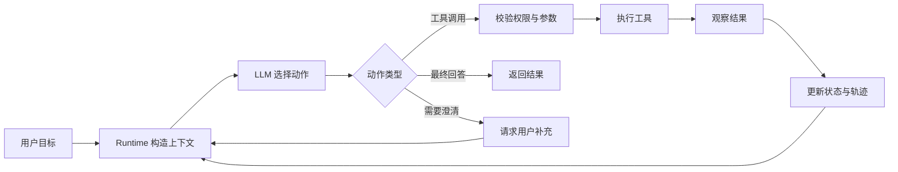
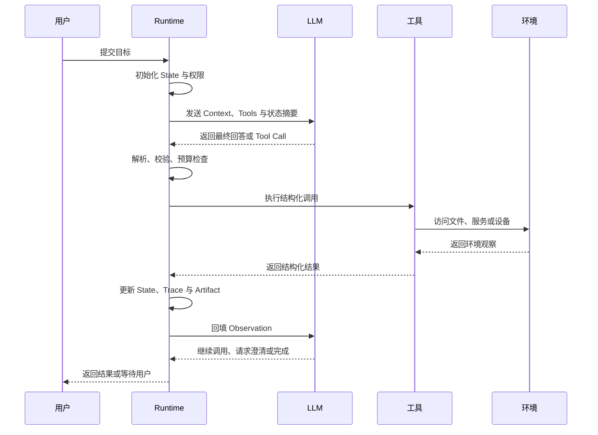
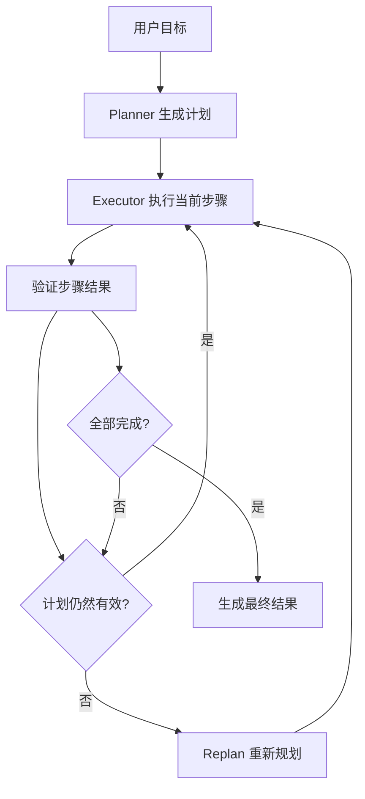
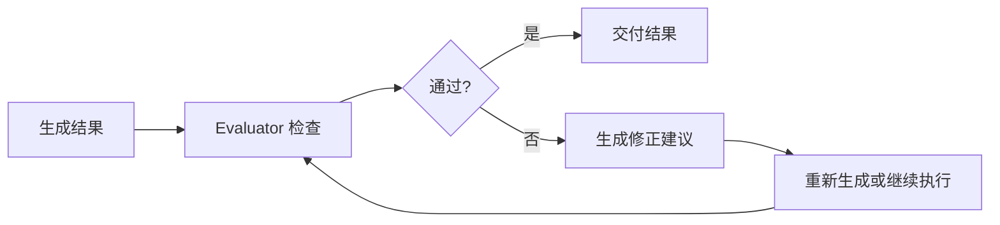

# Agent 基础概念

如果你使用过 ChatGPT、Cursor、Deep Research、Manus 或 OpenClaw，已经接触过不同形态的 Agent。它们的界面和能力范围差异很大，但都在解决同一类问题：把用户给出的目标转化为一系列行动，读取环境反馈，再继续推进任务。

这类系统与普通聊天的区别，不在于回答更长，也不在于界面更复杂。关键在于系统拥有一个持续运行的任务循环：理解目标、获取信息、选择动作、执行动作、检查结果，并根据新结果调整下一步。

本文从 Agent 的基本定义开始，依次介绍现代 Agent 的核心组成、LLM API、上下文、工具和 Runtime，最后比较 ReAct、Plan-and-Execute 与 Reflection 三种常见运行模式。文中的概念以 [AI Agent Book](https://github.com/bojieli/ai-agent-book) 为主要参考，并结合博客后续章节中的工具、协议和设计模式展开。

## 1. Agent 的基本定义

### 1.1 什么是 Agent

在经典人工智能中，Agent 是能够感知环境、根据目标做出决策并采取行动的系统。环境可以是物理世界，也可以是软件世界；感知可以来自传感器、用户输入、文件、网页或数据库；行动可以是移动机械臂、调用 API、写入文件或发送消息。

把这个定义放到大模型应用中，可以得到一个实用版本：

> Agent 是围绕目标运行的软件系统。它使用模型理解任务和选择动作，通过上下文获得当前状态，通过工具观察或改变外部环境，并在 Runtime 的控制下持续推进，直到完成、暂停或终止。

这里有四个关键词：

| 关键词 | 含义 |
| --- | --- |
| 目标 | 用户希望系统达到的结果，以及完成标准 |
| 观察 | Agent 当前能看到的信息，包括用户输入、文件内容、网页结果和工具返回值 |
| 动作 | Agent 可以执行的操作，例如搜索、读取、修改、运行测试或请求用户确认 |
| 循环 | 动作改变环境后，环境产生新的观察，系统据此决定下一步 |

Agent 不等于“会调用模型的聊天页面”。一次模型调用可以完成一轮问答，但 Agent 需要管理多轮行动、状态、失败、预算和终止条件。

### 1.2 从 ChatGPT 到通用 Agent

理解 Agent 的一种好方法，是观察人机交互能力如何逐步扩展。

**第一阶段：ChatGPT 式对话。** 用户输入问题，模型根据当前对话生成回答。上下文主要是对话历史，动作主要是输出文本。系统无法主动读取用户没有提供的资料，也不能直接修改外部系统。

**第二阶段：工具调用与 MCP。** 应用把搜索、数据库、文件系统、代码解释器等能力描述成结构化工具。模型选择工具并生成参数，Runtime 执行工具，再把结果放回上下文。MCP 进一步把工具和资源的发现、连接与调用标准化，让同一套能力可以被多个 Host 或 Agent 使用。

**第三阶段：Workflow。** 当业务步骤稳定后，开发者把流程写进程序，例如“检索资料→抽取字段→调用接口→生成报告”。Workflow 的路径由代码控制，模型负责其中某些局部任务。它容易测试，适合边界清楚的业务流程。

**第四阶段：Coding Agent。** Coding Agent 把代码仓库作为环境，使用搜索、读取、编辑、命令执行和测试工具，围绕一个目标反复工作：理解需求、定位代码、修改文件、运行验证、根据错误继续修复。软件工程已有测试、类型检查、Lint、Git 和沙盒，这些设施天然提供了强反馈和回退能力。

**第五阶段：通用 Agent。** 通用 Agent 将多个观察通道和动作接口组合起来，同时处理网页、文件、代码、数据库和用户沟通。它可以在任务过程中动态选择路径，完成跨系统任务。

**第六阶段：个人环境中的常驻 Agent。** OpenClaw 等本地优先的个人助手把消息渠道、本地文件、云应用和定时事件接入同一套 Agent。Agent 的观察空间扩展到用户授权的数字生活，动作空间也扩展到消息、文件和业务操作。

这条演进路线可以概括为：模型能看到什么，决定它能理解什么；工具允许做什么，决定它能完成什么；Runtime 如何组织循环，决定它能否可靠完成。

### 1.3 LLM 问答、RAG、Workflow 与 Agent

这些概念经常被放在一起。区分它们时，重点看任务路径由谁决定，以及系统是否根据中间结果继续行动。

| 形态 | 主要行为 | 适合场景 | 局限 |
| --- | --- | --- | --- |
| LLM 问答 | 模型基于输入直接生成回答 | 问题简单、资料已在上下文中 | 不会主动获取新信息 |
| RAG | 先检索，再生成回答 | 文档问答、知识库查询 | 后续动作通常由固定流程控制 |
| Workflow | 程序固定安排每个步骤 | 抽取、审批、转换和稳定业务链路 | 分支变多后维护成本上升 |
| Agent | 模型根据观察选择下一步动作 | 调研、代码修复、跨系统任务 | 成本、延迟、权限和调试更复杂 |

RAG 可以是一个固定流程，也可以是 Agent 的一个工具。任务路径稳定时，Workflow 往往更合适；任务需要根据搜索结果、工具错误或用户反馈改变路径时，Agent 循环更有价值。

### 1.4 Agent、Harness 与 Environment

AI Agent Book 使用两个互补的抽象层次描述 Agent。

第一个层次是最小工程公式：

> **Agent = LLM + Context + Tools**

第二个层次是生产系统公式：

> **Agent = Model + Harness**
>
> **Harness = 上下文管理 + 工具接口 + 约束 + 验证 + 纠正**
>
> **Agent ↔ Environment**

两组公式描述的是不同层次。LLM 是决策核心；Context 和 Tools 是模型与世界连接的基本接口；Harness 则是围绕模型构建的运行与治理层。

三者边界如下：

| 对象 | 负责什么 | 例子 |
| --- | --- | --- |
| Agent | 理解目标、选择动作、推进任务 | 编码 Agent、研究 Agent、个人助手 |
| Harness / Runtime | 组织上下文、暴露工具、校验权限、执行循环、记录轨迹 | 工具注册表、状态存储、沙盒、重试和审批 |
| Environment | 接收动作并产生真实状态变化 | 文件系统、数据库、网页、终端、用户和物理设备 |

Environment 不属于 `LLM + Context + Tools` 这个最小公式。工具是 Agent 访问环境的接口，文件内容、数据库记录和浏览器页面属于环境本身。

### 1.5 观察空间与动作空间

Agent 与环境之间有两个关键接口：

- **观察空间**：环境中哪些信息可以进入 Agent 的上下文。
- **动作空间**：Agent 可以向环境发出哪些操作。

没有进入观察空间的信息，对模型来说就等同于未知；没有进入动作空间的能力，模型即使知道解决办法，也只能给出建议。

因此，提升 Agent 能力时，常见做法是扩展或重新设计观察空间和动作空间：

| Agent 类型 | 观察空间 | 动作空间 |
| --- | --- | --- |
| Coding Agent | 需求、目录、代码片段、编译和测试输出 | 搜索、读取、编辑、命令执行、测试 |
| Research Agent | 搜索结果、网页、论文、引用和数据 | 搜索、打开网页、提取内容、计算、写报告 |
| Computer Use Agent | 截图、DOM、无障碍树、操作反馈 | 点击、输入、滚动、拖拽、截图 |
| 个人助手 | 消息、日历、文件、账号记录和用户确认 | 发消息、创建日程、读写文件、调用业务 API |

这个视角也解释了为什么 Manus、Coding Agent 和 OpenClaw 的能力边界会持续扩展：它们不断合并新的观察通道和动作接口。

## 2. 现代 Agent 的核心公式

### 2.1 Agent = LLM + Context + Tools

现代 Agent 的最小运行单元可以写成：

```text
Agent = LLM + Context + Tools
```

这三个部分各自承担不同职责：

| 组件 | 作用 | 主要问题 |
| --- | --- | --- |
| LLM | 理解意图、规划任务、选择动作、生成结果 | 能否在当前上下文中做出合理决策 |
| Context | 提供模型当前需要看到的信息 | 信息是否完整、相关、及时且可控 |
| Tools | 让 Agent 获取信息或执行操作 | 能力是否清晰、权限是否受限、结果是否结构化 |

可以用“大脑、思维载体、手脚”帮助记忆：LLM 负责决策，Context 承载决策所需的信息，Tools 连接外部世界。

### 2.2 一次 Agent 交互的最小闭环

一次完整的工具交互通常包含以下步骤：

1. Runtime 将用户目标、当前状态和可用工具说明放入上下文。
2. LLM 判断直接回答，还是提出一个工具调用。
3. Runtime 解析调用，检查工具名称、参数、权限和预算。
4. 工具访问环境并返回观察结果。
5. Runtime 将观察结果写入轨迹和状态，再次调用 LLM。
6. LLM 继续调用工具、请求用户输入，或生成最终结果。



模型提出的是候选动作，Runtime 才拥有实际执行权。这个边界是 Agent 安全和可调试性的基础。

### 2.3 从最小公式到 Harness

只提供模型、上下文和工具，可以做出一个能运行的 Demo。生产系统还需要三类能力：

- **约束**：限制路径、命令、数据范围、权限和副作用。
- **验证**：检查工具结果、测试结果、输出格式和任务完成条件。
- **纠正**：对可恢复错误重试、调整上下文、重新规划或交给人工。

这就是 Harness 工程。它关注的范围比提示词更大：不仅管理模型看到什么，还管理模型如何行动、行动后如何验证，以及失败后如何恢复。

## 3. LLM：Agent 的大脑

### 3.1 LLM 在 Agent 中负责什么

LLM 是 Agent 的决策核心，主要承担四类工作：

1. **理解目标**：识别用户真正想完成的事情、输出格式和约束条件。
2. **拆解任务**：把复杂目标转换成可执行的步骤或候选动作。
3. **选择动作**：决定是否调用工具、调用哪个工具、传入哪些参数。
4. **综合结果**：根据观察、证据和验证结果生成最终回答或下一步计划。

预训练提供语言、代码和世界知识；后训练可以让模型更稳定地遵循指令、使用工具和完成长链任务。工具的真实执行仍由 Runtime 和外部系统负责。

### 3.2 模型调用的基本结构

无论使用哪一家模型服务，调用都可以抽象成四部分：

| 部分 | 内容 |
| --- | --- |
| 模型标识 | 使用哪个模型和推理配置 |
| 指令与上下文 | 系统规则、用户目标、历史轨迹和状态 |
| 工具定义 | 工具名称、描述、参数 schema 和调用策略 |
| 输出 | 文本、工具调用、结构化结果或停止原因 |

下面是 OpenAI Chat Completions 风格的简化请求：

```json
{
  "model": "gpt-5",
  "messages": [
    {
      "role": "system",
      "content": "你是一个代码助手。先读取相关文件，再提出修改。"
    },
    {
      "role": "user",
      "content": "定位登录页的错误并给出修复方案。"
    }
  ],
  "tools": [
    {
      "type": "function",
      "function": {
        "name": "rg",
        "description": "在授权工作区内搜索文本",
        "parameters": {
          "type": "object",
          "properties": {
            "query": {"type": "string"},
            "path": {"type": "string"}
          },
          "required": ["query", "path"]
        }
      }
    }
  ],
  "tool_choice": "auto"
}
```

模型可能返回工具调用：

```json
{
  "choices": [
    {
      "message": {
        "role": "assistant",
        "content": null,
        "tool_calls": [
          {
            "id": "call_01",
            "type": "function",
            "function": {
              "name": "rg",
              "arguments": "{\"query\":\"login\",\"path\":\"src\"}"
            }
          }
        ]
      },
      "finish_reason": "tool_calls"
    }
  ]
}
```

Runtime 执行后，需要把结果以对应的调用 ID 回填：

```json
{
  "role": "tool",
  "tool_call_id": "call_01",
  "content": "{\"ok\":true,\"matches\":[{\"path\":\"src/login.ts\",\"line\":42}]}"
}
```

OpenAI Responses API 使用另一种事件化结构，但语义相同：模型输出 `function_call`，Runtime 执行后回传 `function_call_output`。开发时应把内部轨迹保存为中立结构，再渲染成具体供应商的请求格式。

### 3.3 模型即 Agent

部分新模型把工具选择、长链规划和任务接续能力通过后训练内化到模型行为中，服务端也可以代为执行搜索、代码解释器等工具。这种形态常被称为“模型即 Agent”。

它改变的是编排位置：循环可能从客户端 Runtime 移到模型服务端。工具实现、权限、环境状态、用户确认和结果验证仍然属于模型之外的基础设施。模型能力增强后，Harness 的价值依旧存在，重点会转向上下文管理、可靠执行、安全边界和结果验证。

## 4. Context：Agent 的思维载体

### 4.1 Context 不只是聊天记录

Context 是某个决策点送入模型的信息表示。它通常包含：

| 内容 | 作用 |
| --- | --- |
| 系统指令 | 角色、任务规则、输出要求和行为约束 |
| 用户请求 | 当前目标、偏好和补充条件 |
| 对话历史 | 用户与 Agent 之前的交互 |
| 工具定义 | 可调用能力、参数 schema 和限制 |
| 工具观察 | 搜索结果、文件片段、API 返回值和错误 |
| 记忆与知识 | 跨会话偏好、领域资料和检索结果 |
| Agent 状态 | 计划、已完成步骤、证据、资料缺口和预算 |
| Runtime 元数据 | 当前时间、工作目录、权限、trace id 和模型配置 |

Context 决定模型在当前轮次能够做出什么判断。长任务中，完整消息历史不能替代结构化状态：历史保留过程，状态表达当前进展，知识库保存可复用资料。

### 4.2 上下文的组织方式

一个常见的上下文结构如下：

```text
静态前缀：系统指令、工具定义、稳定规则
任务输入：用户目标、输出格式、权限范围
动态信息：记忆、检索结果、当前状态摘要
执行轨迹：模型动作、工具结果、错误和验证信息
```

静态内容可以放在前面，动态内容放在后面，便于缓存和复用。工具结果要带来源、截断状态和错误类型；网页、文档、代码注释和上传文件都应被视为外部资料，不能自动获得系统指令的地位。

### 4.3 OpenAI 与 Anthropic 的消息结构

OpenAI 和 Anthropic 的 API 都支持多轮对话与工具调用，但字段名称和消息形态不同。两者可以表达相同语义，内部不要直接把某一家 API 的消息对象当作通用轨迹格式。

#### OpenAI 风格

OpenAI Chat Completions 常见角色包括 `system`、`user`、`assistant` 和 `tool`：

| 字段 | 含义 |
| --- | --- |
| `messages` | 按顺序排列的消息历史 |
| `role` | 消息角色，如 `system`、`user`、`assistant`、`tool` |
| `content` | 文本或多模态内容 |
| `tools` | 工具定义列表 |
| `tool_choice` | 是否自动选择工具、指定工具或禁止工具 |
| `tool_calls` | Assistant 发出的工具调用列表 |
| `tool_call_id` | Tool 结果对应的调用 ID |
| `finish_reason` | 本轮停止原因，如完成、长度限制或工具调用 |

Responses API 将输入和输出拆成更细的项目，例如 `message`、`function_call`、`function_call_output`。它更适合流式事件和服务端工具，但仍遵循“模型提出动作—Runtime 执行—结果回填”的基本循环。

#### Anthropic 风格

Anthropic Messages API 通常把系统指令放在顶层 `system` 字段，`messages` 主要使用 `user` 和 `assistant` 两种角色，消息内容由内容块组成：

| 字段 | 含义 |
| --- | --- |
| `system` | 系统级指令，不放在普通消息列表中 |
| `messages` | 用户与 Assistant 的多轮消息 |
| `content` | 文本、图片、`tool_use`、`tool_result` 等内容块 |
| `tools` | 工具定义列表 |
| `input_schema` | 工具参数的 JSON Schema |
| `tool_choice` | 工具选择策略 |
| `stop_reason` | 停止原因，如 `end_turn`、`max_tokens`、`tool_use` |

Anthropic 风格的工具定义示例：

```json
{
  "model": "claude-sonnet",
  "max_tokens": 2048,
  "system": "你是一个受限工作区内的代码助手。",
  "messages": [
    {
      "role": "user",
      "content": "搜索登录页的实现。"
    }
  ],
  "tools": [
    {
      "name": "rg",
      "description": "在授权工作区内搜索文本",
      "input_schema": {
        "type": "object",
        "properties": {
          "query": {"type": "string"},
          "path": {"type": "string"}
        },
        "required": ["query", "path"]
      }
    }
  ],
  "tool_choice": {"type": "auto"}
}
```

模型返回工具使用内容块：

```json
{
  "stop_reason": "tool_use",
  "content": [
    {
      "type": "tool_use",
      "id": "toolu_01",
      "name": "rg",
      "input": {"query": "login", "path": "src"}
    }
  ]
}
```

Runtime 以 `tool_result` 内容块回填：

```json
{
  "role": "user",
  "content": [
    {
      "type": "tool_result",
      "tool_use_id": "toolu_01",
      "content": "{\"ok\":true,\"matches\":[{\"path\":\"src/login.ts\",\"line\":42}]}"
    }
  ]
}
```

#### 中立轨迹格式

为了支持模型切换、评估回放和故障接管，建议在 Runtime 内部保存中立轨迹：

```json
{
  "task_id": "task-001",
  "events": [
    {
      "type": "user_input",
      "text": "搜索登录页的实现。"
    },
    {
      "type": "tool_call",
      "call_id": "call-001",
      "name": "rg",
      "arguments": {"query": "login", "path": "src"}
    },
    {
      "type": "tool_result",
      "call_id": "call-001",
      "ok": true,
      "data": {"matches": [{"path": "src/login.ts", "line": 42}]}
    }
  ]
}
```

供应商专属字段，例如思考凭证、事件 ID 和内容块签名，应在适配层处理。轨迹的核心语义应保持独立：目标、动作、参数、观察、错误、状态和最终结果。

### 4.4 Context Engineering

上下文工程关注信息如何进入、留在和离开模型上下文，常见手段包括：

- **状态摘要**：把已完成步骤、证据和资料缺口压缩成结构化摘要。
- **上下文压缩**：保留用户约束、关键观察和未解决问题，移除重复输出。
- **按需检索**：只在当前任务需要时加载知识和 Skill。
- **上下文隔离**：把独立子任务交给子 Agent，减少主任务的信息干扰。
- **缓存友好**：稳定指令和工具定义保持不变，动态内容追加在末尾。
- **来源标记**：区分用户指令、系统规则、工具观察和不可信外部资料。

上下文越长不代表信息越充分。高质量 Context 应让模型知道目标是什么、已经完成什么、当前证据有哪些、还缺什么，以及下一步允许做什么。

## 5. Tools：Agent 与外界交互的能力

### 5.1 工具调用的角色分工

工具调用至少涉及四个角色：

| 角色 | 职责 |
| --- | --- |
| LLM | 根据上下文选择工具并生成参数 |
| Runtime | 校验 schema、权限、预算和副作用，决定是否执行 |
| Tool Adapter | 将结构化参数转换为 CLI、SDK、数据库或 HTTP 调用 |
| Environment | 执行动作并返回真实观察结果 |

模型输出的工具调用只是请求。工具执行、文件修改、网络访问和消息发送都必须经过 Runtime 与工具适配器。

### 5.2 工具的五类能力

AI Agent Book 将工具按 Agent 与外界交互的方向归纳为五类：

| 类型 | 作用 | 例子 |
| --- | --- | --- |
| 感知工具 | 获取环境信息 | 搜索、读取文件、网页、数据库和图像理解 |
| 执行工具 | 改变环境状态 | 写文件、运行命令、调用 API、创建资源 |
| 协作工具 | 与其他 Agent 或人协作 | 委托子任务、请求确认、发送进度 |
| 事件工具 | 接收外部事件并触发任务 | 邮件、Webhook、定时器、队列消息 |
| 用户沟通工具 | 向用户传递信息或请求输入 | 聊天、邮件、语音和动态表单 |

工具也可以按风险分级。搜索和读取通常属于低风险能力；写文件、发消息、修改生产配置、删除数据和支付操作需要更严格的权限、预览、确认和审计。

### 5.3 `rg`、`read`、`write` 与测试工具

Coding Agent 中最常见的基础工具可以这样理解：

| 工具 | 解决的问题 | 关键参数 | Runtime 约束 |
| --- | --- | --- | --- |
| `rg` | 在授权目录内搜索文本 | 查询、路径、是否大小写敏感、结果上限 | 限制路径、结果数、输出大小和超时 |
| `read` | 读取文件或指定行范围 | 路径、起始行、行数 | 防止路径越界和一次读取过多内容 |
| `write` / `apply_patch` | 修改工作区文件 | 路径、内容或 diff | 检查权限、冲突、覆盖行为并记录 diff |
| `run_tests` | 验证修改是否有效 | 测试目标、命令类型、超时 | 限制命令集合，返回退出码和摘要 |

一个 `rg` 工具的 schema 可以写成：

```json
{
  "name": "rg",
  "description": "在授权工作区内搜索文本，返回文件、行号和少量上下文。",
  "input_schema": {
    "type": "object",
    "properties": {
      "query": {"type": "string", "description": "搜索文本"},
      "path": {"type": "string", "description": "工作区内的相对路径"},
      "fixed_string": {"type": "boolean", "default": true},
      "max_results": {"type": "integer", "minimum": 1, "maximum": 100}
    },
    "required": ["query", "path"]
  }
}
```

工具结果也应结构化：

```json
{
  "ok": true,
  "tool": "rg",
  "summary": "在 3 个文件中找到 8 处匹配。",
  "data": [
    {
      "path": "src/login.ts",
      "line": 42,
      "text": "createLoginPage()"
    }
  ],
  "metadata": {
    "truncated": false,
    "elapsed_ms": 31
  }
}
```

失败结果也应保留机器可读字段：

```json
{
  "ok": false,
  "tool": "read",
  "error_type": "PathOutsideWorkspace",
  "message": "请求路径不在授权工作区内。",
  "retryable": false
}
```

结构化错误可以让模型调整参数或停止当前路径，也方便 Runtime、评测系统和审计日志进行归因。

### 5.4 工具设计原则

**名称直观。** `search_notes`、`read_file`、`run_tests` 比含义宽泛的 `query`、`open`、`run` 更容易被正确选择。

**能力边界清楚。** 工具描述需要说明可以访问什么、不能访问什么、参数从哪里取、输出包含哪些字段。

**结果有上限。** 搜索结果、文件片段、网页内容和命令输出都应限制数量、字节数和执行时间。

**错误可恢复。** 结果应区分参数错误、权限拒绝、超时、限流、环境故障和业务失败，并标注是否值得重试。

**副作用可见。** 写文件、发消息和修改数据应返回变更摘要，必要时先展示预览并等待用户确认。

**专用能力承担高风险规则。** 通用代码执行器适合探索和组合；支付、删除、生产部署等操作应使用权限明确、参数受限、可审计的专用工具。

### 5.5 Function Calling、MCP 与 Skill

这三者处在不同层次：

| 机制 | 解决的问题 |
| --- | --- |
| Function Calling | 模型如何生成结构化工具调用 |
| MCP | Host 与外部工具、资源和提示之间如何发现与通信 |
| Skill | 如何按需加载一组说明、脚本、资源和执行步骤 |

Function Calling 常是 Runtime 的内部接口；MCP 提供跨应用的能力连接；Skill 提供面向任务的能力打包。它们可以组合使用：Runtime 通过 MCP 发现工具，再把筛选后的 schema 以 Function Calling 形式提供给模型。

## 6. Agent Runtime

### 6.1 Runtime 的职责

Runtime 是 Agent 的执行中枢，职责包括：

- 接收用户目标并初始化任务状态。
- 构造当前轮次的上下文。
- 向模型提供工具定义和调用策略。
- 解析模型输出，识别最终回答、工具调用和用户澄清请求。
- 校验工具名称、参数 schema、路径、权限、预算和副作用。
- 执行工具并标准化结果。
- 更新状态、轨迹、产物和错误记录。
- 判断是否继续、暂停、重试、重新规划或终止。
- 记录可回放的 trace，支持评估、审计和故障恢复。

模型负责候选决策，Runtime 负责受控执行。把这两个职责混在一起，会让权限、调试和失败恢复变得困难。

### 6.2 Runtime 的状态

完整消息历史不等于任务状态。一个长任务通常需要维护：

| 状态字段 | 内容 |
| --- | --- |
| `goal` | 用户目标和完成标准 |
| `plan` | 当前计划、步骤和依赖 |
| `trajectory` | 模型动作、工具调用、观察和错误 |
| `evidence` | 可引用的事实和来源 |
| `artifacts` | 补丁、报告、生成文件和其他产物 |
| `budget` | 轮次、token、工具调用、时间和成本 |
| `permissions` | 当前允许访问的目录、服务和动作 |
| `status` | 运行中、等待输入、已完成、失败或取消 |

状态应支持序列化和 checkpoint。任务中断时可以从最近状态恢复，评测时可以回放同一条轨迹。

### 6.3 终止与失败处理

Runtime 需要明确结束条件：

- 模型生成满足要求的最终结果。
- 已获得覆盖目标的证据并完成验证。
- 达到最大轮次、时间、token 或成本预算。
- 连续多轮没有新增证据或重复相同动作。
- 工具权限不足，且无法通过用户授权继续。
- 工具返回不可恢复错误。
- 任务缺少必要信息，需要用户补充。

错误处理应先分类，再决定是否重试。限流、网络抖动和临时超时可能适合指数退避；参数错误、路径越界和权限拒绝需要改变输入或停止当前路径。工具错误可以作为结构化观察回填给模型，模型再决定修正参数、换用工具或结束任务。

### 6.4 Runtime 执行流程



## 7. 三种 Agent Runtime 模式

### 7.1 ReAct：边观察边行动

ReAct 将推理与行动放在一个循环中。每一轮根据当前上下文选择动作，执行后读取观察，再决定下一步：

```text
目标 → 判断 → Action → Observation → 判断 → Action → … → Final
```

典型轨迹如下：

```json
{
  "events": [
    {"type": "user_input", "text": "修复登录页错误"},
    {"type": "tool_call", "name": "rg", "arguments": {"query": "login", "path": "src"}},
    {"type": "tool_result", "ok": true, "data": {"matches": ["src/login.ts:42"]}},
    {"type": "tool_call", "name": "read", "arguments": {"path": "src/login.ts", "start_line": 35, "line_count": 40}},
    {"type": "tool_result", "ok": true, "data": {"content": "..."}},
    {"type": "final", "answer": "已定位错误位置，并给出修复结果。"}
  ]
}
```

**优点：** 能根据最新观察动态调整路径，适合搜索、调试和探索性任务。

**问题：** 可能重复调用、过早结束或在长任务中丢失全局目标；需要最大轮次、重复动作检测、预算和状态摘要。

ReAct 中的“思考”是模型内部决策过程。产品可以记录结构化事件和简短决策摘要，不应把供应商专属的隐藏推理凭证直接当作通用数据保存或展示。

### 7.2 Plan-and-Execute：先规划，再执行

Plan-and-Execute 将任务拆成两个阶段：Planner 生成计划，Executor 按步骤调用工具并验证结果。



计划可以用结构化数据表示：

```json
{
  "goal": "整理向量数据库选型建议",
  "steps": [
    {"id": "s1", "task": "搜索本地笔记中的向量数据库内容", "status": "pending"},
    {"id": "s2", "task": "读取 HNSW、pgvector 和 Milvus 相关证据", "status": "pending"},
    {"id": "s3", "task": "按延迟、成本和运维复杂度生成比较", "status": "pending"}
  ]
}
```

**优点：** 适合步骤较多、需要进度展示、产物管理和长时间运行的任务。

**问题：** 初始计划可能建立在错误假设上；环境变化或工具失败后，必须允许重新规划，不能机械执行过期步骤。

实际系统常采用混合方式：先生成高层计划，再让每个步骤内部运行短 ReAct 循环。

### 7.3 Reflection：执行后评估与修正

Reflection 在生成结果或完成一个阶段后，引入 Evaluator 检查结果是否满足标准；发现问题后，Optimizer 生成修正版。



Reflection 的有效性依赖可验证反馈：

| 任务 | 可用反馈 |
| --- | --- |
| 代码修改 | 测试、Lint、类型检查和构建结果 |
| 资料整理 | 来源覆盖、引用检查和事实核对 |
| 数据处理 | schema、统计规则和样本校验 |
| 文案生成 | 格式规则、禁用词和人工评价 |

只有让模型再次评价自己的文字，不能充分证明事实正确。Reflection 应尽量读取测试结果、工具返回值、规则检查和人工反馈。Reflexion 还可以把失败经验写入后续轨迹或记忆，但经验需要有来源和适用范围。

### 7.4 三种模式的选择

| 模式 | 主要控制点 | 适合任务 | 主要风险 |
| --- | --- | --- | --- |
| ReAct | 每轮根据观察选择动作 | 搜索、调试、开放探索 | 重复调用、路径漂移 |
| Plan-and-Execute | 计划、步骤、依赖和重规划 | 长任务、报告、跨阶段产物 | 计划过期、执行僵化 |
| Reflection | 结果评估、反馈和修正 | 代码、文档、结构化输出 | 自评缺少证据、循环成本上升 |

可以组合使用：

```text
高层 Plan-and-Execute
  └─ 每个步骤内部使用 ReAct
       └─ 阶段结束后使用 Reflection 验证
```

选择原则是从简单结构开始，只在任务确实需要时增加规划、反思或多 Agent 协作。模式越复杂，状态、错误、预算和观测要求越高。

## 8. 从 Demo 到可靠 Agent

### 8.1 可靠性来自 Harness

Agent 的能力不只来自模型。生产级系统需要围绕模型建立一层可观察、可验证、可恢复的 Harness：

| 能力 | 最小要求 |
| --- | --- |
| 权限 | 工具按用户、目录、租户和任务阶段限制 |
| 沙盒 | 文件写入和命令执行运行在隔离环境 |
| 验证 | 测试、规则、schema 或人工检查提供反馈 |
| 纠正 | 重试、接续、调整参数、重规划和人工接管 |
| 可观测性 | 模型调用、工具调用、状态变化和耗时都有 trace |
| 回退 | Git、快照、草稿和可逆操作保护环境 |
| 预算 | 限制轮次、token、工具调用、时间和成本 |

Coding Agent 的成熟度较高，很大程度上来自软件工程长期积累的 Harness：测试套件提供验收标准，Lint 和类型系统提供即时反馈，Git 提供回退路径，沙盒限制副作用。

### 8.2 安全边界

Agent 会把外部资料带入上下文，也可能对外部系统产生真实影响。Runtime 至少应注意：

- 将网页、文件、邮件和工具输出标记为不可信资料，防止提示注入改变系统规则。
- 对文件路径、命令、网络地址、数据查询和消息接收者做程序化限制。
- 高风险动作提供预览、确认、审计和恢复路径。
- 工具输出设置大小、数量和时间上限，避免上下文污染和资源耗尽。
- 记录用户、模型、工具、参数摘要、结果摘要、错误和 trace id。
- 连续失败、重复动作和无进展循环达到阈值时暂停任务。

安全约束应尽量放在程序、权限系统和数据层。提示词可以解释规则，Runtime 和 Environment 才能真正执行规则。

### 8.3 什么时候使用 Agent

可以用下面的问题判断是否需要 Agent：

1. 任务是否需要访问模型当前看不到的信息？
2. 任务是否包含多个步骤，且下一步取决于上一步结果？
3. 任务是否需要改变文件、数据库、网页或其他环境？
4. 任务路径是否难以提前写成固定流程？
5. 是否有足够的验证反馈、权限边界和失败恢复能力？

如果路径稳定、输入输出明确，优先使用普通 API 或 Workflow。如果路径需要动态探索，再引入 Agent 循环。Agent 带来的是适应性，也带来更多执行成本和治理工作。

## 9. 小结

本文可以压缩为一份认知地图：

1. Agent 围绕目标运行，通过观察和动作与 Environment 形成闭环。
2. 现代 Agent 的最小公式是 `Agent = LLM + Context + Tools`。
3. LLM 负责理解、规划和选择动作；Context 负责承载当前决策信息；Tools 负责连接外部世界。
4. Runtime / Harness 负责上下文组装、工具执行、状态管理、权限、验证、纠正和终止。
5. ReAct 适合动态探索，Plan-and-Execute 适合长任务，Reflection 适合基于反馈迭代质量。
6. 可靠 Agent 的核心不只是“能调用工具”，还包括清晰的接口、可验证的结果、可追踪的轨迹和可恢复的失败路径。

后续阅读：

- [工具调用](./工具调用.md)：深入 Function Calling、schema、`rg`、文件读写和测试工具。
- [常见协议](./常见协议.md)：深入 MCP、A2A、ACP、传输方式和协议边界。
- [设计模式](./设计模式.md)：深入 ReAct、Plan-and-Execute、Reflection、多 Agent 协作和框架选型。
- [记忆类型](../记忆治理/记忆类型.md)：区分短期状态、长期记忆、情景记忆和语义记忆。

## 参考资料

- [AI Agent Book：深入理解 AI Agent](https://github.com/bojieli/ai-agent-book)
- [AI Agent Book 第 1 章：AI Agent 入门](https://github.com/bojieli/ai-agent-book/blob/main/book/chapter1.md)
- [AI Agent Book 第 2 章：上下文工程](https://github.com/bojieli/ai-agent-book/blob/main/book/chapter2.md)
- [AI Agent Book 第 4 章：工具](https://github.com/bojieli/ai-agent-book/blob/main/book/chapter4.md)
- [AI Agent Book 第 5 章：Coding Agent 与通用 Agent](https://github.com/bojieli/ai-agent-book/blob/main/book/chapter5.md)
- [Anthropic：Building effective agents](https://www.anthropic.com/research/building-effective-agents)
- [Model Context Protocol](https://modelcontextprotocol.io/)
- [OpenAI Agents SDK](https://openai.github.io/openai-agents-python/)
