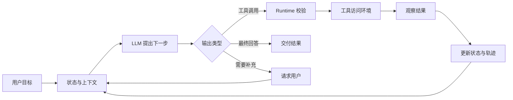
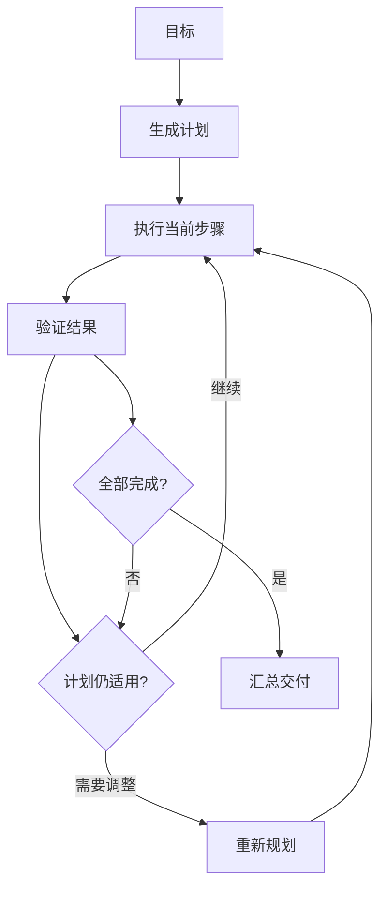
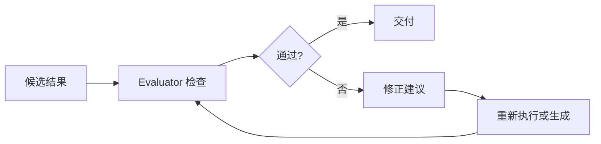

# Agent 基础概念

很多产品都把自己称为 Agent。聊天助手、代码助手、网页操作助手和常驻个人助手看起来差别很大，底层却共享一个动作循环：先理解目标，再获取当前情况，选择一个可执行的动作，读取结果，继续推进。

如果系统只负责生成一段文字，它更接近一次模型调用；如果系统能在授权范围内连续观察和操作环境，它才具备 Agent 的基本形态。理解这条边界，比记住某个框架的类名更重要。

## 1. 从一个任务看 Agent

假设用户提出一个目标：“找出本周发布失败的原因，修复代码并给出验证结果。”

一个普通问答模型可以猜测原因、建议排查步骤，但它看不到仓库，也无法运行测试。一个 Agent 会按类似下面的路径工作：

```text
目标
  → 搜索发布日志和相关代码
  → 读取上下文并提出假设
  → 修改补丁
  → 运行测试或构建
  → 根据输出继续修正
  → 汇总证据和结果
```

每一步都可能改变下一步。搜索没有命中时，路径会转向日志或配置；测试失败时，系统会回到代码修改；缺少生产权限时，任务会停下来请求用户接管。Agent 的特征正在于这种“观察—动作—新观察”的连续过程。

## 2. Agent 的基本定义

### 2.1 什么是 Agent

Agent 是一个围绕目标运行的软件系统。它使用模型解释意图和选择动作，把当前状态组织成上下文，通过工具访问环境，并由运行时负责执行、验证、记录和停止。

可以把一个 Agent 任务写成四个问题：

| 问题 | 对应概念 | 说明 |
| --- | --- | --- |
| 要达到什么结果？ | 目标（Goal） | 包含完成标准、输出形式和用户约束 |
| 现在知道什么？ | 观察（Observation） | 用户输入、文件、网页、数据库和工具返回值 |
| 可以做什么？ | 动作（Action） | 搜索、读取、编辑、执行、发消息或请求确认 |
| 什么时候结束？ | 终止（Termination） | 完成、暂停、失败、超预算或等待用户 |

目标、观察和动作构成了 Agent 与环境的接口；反馈让这个接口形成循环。

### 2.2 Agent、Runtime 和 Environment

为了避免把职责混在一起，可以拆成三层：

```text
┌──────────────────────────────────────────┐
│ Agent：理解目标，提出下一步动作           │
│   Model + Context                         │
├──────────────────────────────────────────┤
│ Runtime：校验、调度、执行、验证、记账      │
│   状态、权限、预算、轨迹、恢复             │
├──────────────────────────────────────────┤
│ Environment：真实世界的文件、服务和用户    │
└──────────────────────────────────────────┘
```

工程上常用两条公式描述这个系统：

```text
Agent = LLM + Context + Tools
Agent System = Model + Runtime + Environment
```

第一条公式说明模型如何获得决策所需的输入和能力，第二条公式说明一个可运行系统还必须包含执行控制和真实环境。工具是连接 Runtime 与 Environment 的接口，模型输出的调用请求并不等于动作已经发生。

### 2.3 观察空间和动作空间

Agent 能力的上限，常常由两个空间决定：

- **观察空间**：允许进入上下文的信息范围。没有被读取、检索或暴露给模型的内容，对它来说就是未知。
- **动作空间**：Runtime 允许执行的操作集合。模型即使知道解决办法，也不能调用动作空间之外的能力。

| 场景 | 观察空间 | 动作空间 |
| --- | --- | --- |
| 代码修复 | 需求、目录、源码、测试输出、Git diff | 搜索、读取、编辑、运行测试 |
| 资料研究 | 搜索结果、网页正文、论文、引用 | 搜索、打开、提取、计算、写报告 |
| 网页操作 | 截图、DOM、焦点元素、操作反馈 | 点击、输入、滚动、拖拽、提交 |
| 个人助理 | 消息、日历、文件、用户偏好 | 发消息、建日程、读写文件、调用业务接口 |

扩展 Agent 的能力，通常需要同时补充信息入口和可控动作。例如，给代码 Agent 增加“运行测试”比单纯增加一段提示更有价值，因为它带来了新的观察反馈。

### 2.4 Agent 与相邻形态

区分 LLM、RAG、Workflow 和 Agent，可以看“谁决定下一步”：

| 形态 | 下一步由谁决定 | 典型用途 |
| --- | --- | --- |
| LLM 问答 | 模型生成回答后结束 | 解释概念、改写文本、简单问答 |
| RAG | 程序预设检索流程 | 知识库问答、文档检索 |
| Workflow | 代码安排固定步骤 | 审批、抽取、转换、批处理 |
| Agent | 模型根据新观察选择动作 | 调试、调研、跨系统操作 |

RAG 可以是 Workflow 中的一步，也可以作为 Agent 的搜索工具。路径稳定且验收条件清楚时，固定流程更容易维护；路径依赖实时信息，需要临场选择时，Agent 循环才有明显收益。

## 3. 现代 Agent 的三个组成部分

### 3.1 核心公式

```text
Agent = LLM + Context + Tools
```

这三个词可以作为排查系统问题时的一张地图：

| 部分 | 负责什么 | 常见问题 |
| --- | --- | --- |
| LLM | 理解、推断、规划、选择动作、组织回答 | 判断错误、遗漏约束、过早结束 |
| Context | 告诉模型目标、状态、证据和限制 | 信息缺失、过长、来源混淆 |
| Tools | 获取信息或改变环境 | 权限过宽、输出不稳定、副作用不可见 |

只替换模型，无法弥补缺少工具的能力；只增加工具，也无法解决上下文混乱和验收标准缺失。Agent 设计需要把三部分放在一条完整的执行链中考虑。

### 3.2 一轮交互如何推进

一次工具交互通常经历以下步骤：

1. Runtime 创建或恢复任务状态，收集目标、权限和预算。
2. Runtime 组装本轮上下文，并提供当前可用的工具说明。
3. LLM 选择直接回答、调用工具，或请求用户补充信息。
4. Runtime 解析调用，检查 schema、路径、权限、风险和预算。
5. 工具访问环境，返回成功数据或结构化错误。
6. Runtime 保存轨迹和新状态，把观察结果回填给 LLM。
7. 循环继续，直到完成、暂停或达到终止条件。



模型提出的是候选动作，Runtime 才拥有执行权。这个分工让权限、审计和回退都有明确位置。

## 4. LLM：Agent 的决策核心

### 4.1 LLM 做什么，做不到什么

LLM 在 Agent 中主要负责四件事：

1. 从自然语言中提取目标、约束和完成标准。
2. 把目标拆成当前可执行的步骤。
3. 在工具集合中选择动作并生成参数。
4. 综合观察和验证结果，决定继续还是交付。

模型拥有语言和代码方面的先验知识，但它无法凭空知道当前仓库的内容，也不会自动获得数据库写权限。实时事实来自观察，真实副作用来自工具执行，二者都需要 Runtime 组织。

### 4.2 模型请求的共同骨架

不同厂商的字段名称有所差异，调用可以抽象为四块：

| 区块 | 内容 |
| --- | --- |
| 模型配置 | 模型、温度或推理配置、最大输出 |
| 消息与上下文 | 系统规则、用户目标、历史、状态摘要和工具观察 |
| 工具描述 | 名称、用途、参数 schema、调用策略 |
| 模型输出 | 文本、工具调用、结构化内容和停止原因 |

下面用“查找支付回调处理器”的任务展示一种 OpenAI Chat Completions 风格请求：

```json
{
  "model": "gpt-5",
  "messages": [
    {"role": "system", "content": "你在只读工作区中排查问题。先搜索，再读取相关文件。"},
    {"role": "user", "content": "找出支付回调的入口文件，并列出可能影响签名校验的代码。"}
  ],
  "tools": [
    {
      "type": "function",
      "function": {
        "name": "search_text",
        "description": "在授权项目目录内搜索文本，返回路径、行号和匹配片段。",
        "parameters": {
          "type": "object",
          "properties": {
            "query": {"type": "string"},
            "path": {"type": "string"},
            "max_results": {"type": "integer", "minimum": 1, "maximum": 50}
          },
          "required": ["query", "path"]
        }
      }
    }
  ],
  "tool_choice": "auto"
}
```

模型可能返回：

```json
{
  "choices": [
    {
      "message": {
        "role": "assistant",
        "content": null,
        "tool_calls": [
          {
            "id": "call_pay_01",
            "type": "function",
            "function": {
              "name": "search_text",
              "arguments": "{\"query\":\"callback\",\"path\":\"src\",\"max_results\":20}"
            }
          }
        ]
      },
      "finish_reason": "tool_calls"
    }
  ]
}
```

Runtime 执行完成后，再以 `tool_call_id` 关联结果。Responses API 会把这一步表示为 `function_call` 和 `function_call_output` 等项目，基本语义保持一致。

### 4.3 模型调用策略

模型可以由客户端 Runtime 驱动，也可以由服务端托管部分循环。托管式调用减少了客户端编排代码，但权限、业务状态、用户确认和结果验证仍需要应用负责。选型时应关注可观测性、工具兼容性、成本和中断恢复，而不只看模型是否“会自己规划”。

## 5. Context：决定模型此刻能看见什么

### 5.1 Context 的组成

Context 是某个决策点实际送给模型的信息集合。它通常包含：

| 层次 | 内容 | 更新频率 |
| --- | --- | --- |
| 规则 | 系统指令、权限和输出要求 | 低 |
| 目标 | 用户请求、验收标准、偏好 | 中 |
| 能力 | 当前允许使用的工具及 schema | 中 |
| 状态 | 计划、进度、预算、待解决问题 | 高 |
| 观察 | 文件片段、搜索结果、网页和 API 返回值 | 高 |
| 轨迹 | 已执行动作、错误和验证记录 | 高 |
| 记忆 | 跨会话偏好、项目知识和历史结论 | 低到中 |

长对话的消息列表只是原始材料。Runtime 还需要维护结构化状态，例如“已确认回调入口位于 `src/payment/callback.ts`，签名校验尚未验证”。这种摘要能减少重复历史对上下文的挤占。

### 5.2 组织上下文的实用方法

可以把上下文看成一张工作台，而非不断堆叠的聊天记录：

- 把稳定规则和工具定义放在固定前缀，便于缓存。
- 把当前目标、状态摘要和待办放在动态区，确保模型先看到本轮重点。
- 工具结果附带来源、时间、截断标记和错误类型。
- 对独立子任务使用独立上下文，完成后只回传结论和证据。
- 通过摘要、检索和淘汰控制长度；更长的上下文不自动带来更好的判断。
- 明确区分系统规则、用户指令、工具观察和外部资料，避免外部文本伪装成高优先级指令。

### 5.3 OpenAI 与 Anthropic 的消息差异

两类 API 都能表达“消息—工具调用—工具结果”的循环，接入层需要处理字段差异。

| 语义 | OpenAI Chat Completions | Anthropic Messages |
| --- | --- | --- |
| 系统规则 | `messages` 中的 `system` 消息 | 顶层 `system` 字段 |
| 工具定义 | `tools[].function.parameters` | `tools[].input_schema` |
| 模型调用 | `assistant.tool_calls` | `assistant` 内容中的 `tool_use` 块 |
| 工具结果 | `role: tool` + `tool_call_id` | `tool_result` 内容块，回填 `tool_use_id` |
| 停止原因 | `finish_reason` | `stop_reason` |

Anthropic 工具调用的简化形式如下：

```json
{
  "model": "claude-sonnet",
  "max_tokens": 2048,
  "system": "你只能读取授权项目目录。",
  "messages": [
    {"role": "user", "content": "搜索支付回调的处理函数。"}
  ],
  "tools": [
    {
      "name": "search_text",
      "description": "搜索项目文件中的文本。",
      "input_schema": {
        "type": "object",
        "properties": {
          "query": {"type": "string"},
          "path": {"type": "string"}
        },
        "required": ["query", "path"]
      }
    }
  ]
}
```

```json
{
  "stop_reason": "tool_use",
  "content": [
    {
      "type": "tool_use",
      "id": "toolu_pay_01",
      "name": "search_text",
      "input": {"query": "callback", "path": "src"}
    }
  ]
}
```

内部建议保存供应商无关的事件：

```json
{
  "task_id": "payment-debug-17",
  "events": [
    {"type": "user_input", "text": "搜索支付回调的处理函数。"},
    {"type": "tool_call", "call_id": "search-01", "name": "search_text", "arguments": {"query": "callback", "path": "src"}},
    {"type": "tool_result", "call_id": "search-01", "ok": true, "data": {"matches": [{"path": "src/payment/callback.ts", "line": 18}]}}
  ]
}
```

适配层负责把这条轨迹转换成具体厂商的消息格式。这样更换模型、重放任务和排查失败时，不需要重写业务状态。

## 6. Tools：把决策变成可执行动作

### 6.1 工具的分工

工具调用至少经过四个角色：

| 角色 | 工作 |
| --- | --- |
| LLM | 提出工具和参数 |
| Runtime | 校验、授权、调度、超时和审计 |
| 适配器 | 把参数转换为 CLI、SDK、SQL 或 HTTP 调用 |
| Environment | 执行动作并返回状态 |

将模型输出直接交给 shell 或数据库，会把语言模型的偶然错误放大成真实副作用。工具必须由程序层掌握执行权。

### 6.2 Coding Agent 的基础工具

代码 Agent 常见的最小工具集可以按“看、改、验”理解：

| 工具 | 用途 | 应限制什么 |
| --- | --- | --- |
| `rg` / `search_text` | 定位符号、配置和调用关系 | 工作区路径、结果条数、超时 |
| `read` / `read_file` | 读取文件或行范围 | 路径、字节数、敏感文件 |
| `write` / `apply_patch` | 写入新文件或应用差异补丁 | 写入目录、覆盖行为、变更预览 |
| `run_tests` | 执行测试、Lint、构建和类型检查 | 命令白名单、环境变量、执行时长 |

工具名称应表达具体能力。`read_file` 比含义模糊的 `open` 更容易被正确使用；`run_project_tests` 比没有边界的 `run_command` 更容易设置权限。

### 6.3 Schema 和结果设计

schema 是给模型和 Runtime 同时看的接口说明书。除了类型，还应该写明路径范围、默认行为和数量上限：

```json
{
  "name": "search_text",
  "description": "在当前项目内搜索字面量，返回文件、行号和截断信息。",
  "input_schema": {
    "type": "object",
    "properties": {
      "query": {"type": "string", "minLength": 1},
      "path": {"type": "string", "description": "项目内相对路径"},
      "max_results": {"type": "integer", "minimum": 1, "maximum": 100}
    },
    "required": ["query", "path"]
  }
}
```

结果应让模型能判断“下一步做什么”，也让日志系统能回答“刚才发生了什么”：

```json
{
  "ok": true,
  "summary": "找到 2 个匹配，结果未截断。",
  "data": [
    {"path": "src/payment/callback.ts", "line": 18, "text": "verifySignature(payload)"}
  ],
  "metadata": {"truncated": false, "elapsed_ms": 24}
}
```

错误也要结构化：

```json
{
  "ok": false,
  "error_type": "PermissionDenied",
  "message": "当前任务没有写入 production/ 的权限。",
  "retryable": false
}
```

参数错误、权限拒绝、临时超时和业务失败应该分开。模型可以据此修正参数、换工具、等待后重试或结束当前路径。

### 6.4 工具风险与副作用

搜索、读取通常是低副作用操作；写文件、发送消息、改数据库、部署和删除数据会改变环境。高风险工具需要在程序层提供权限、预览、确认、审计和恢复路径。提示词可以说明规则，无法替代这些机制。

一个实用的工具分类是：

| 类别 | 例子 | 设计重点 |
| --- | --- | --- |
| 感知 | 搜索、读取、网页抓取、查询 | 来源、截断、时效 |
| 执行 | 写文件、运行测试、调用 API | 权限、超时、幂等 |
| 协作 | 委托任务、请求确认、更新进度 | 接收者、状态、回执 |
| 触发 | Webhook、队列、定时器 | 去重、签名、重放 |

Function Calling、MCP 和 Skill 解决的问题也不同：Function Calling 规定模型怎样产出结构化调用；MCP 规定 Host 如何发现和连接外部工具、资源与提示；Skill 把某类任务需要的说明、脚本和资料组织成可按需加载的能力包。它们可以叠加在同一个 Runtime 中。

## 7. Agent Runtime：真正负责运行的部分

### 7.1 Runtime 的职责

Runtime 是任务控制器，至少要做这些事情：

- 创建任务并保存目标、权限和预算。
- 根据当前状态构造 Context，筛选工具。
- 解析模型输出，区分最终回答、工具调用和澄清请求。
- 校验参数、路径、风险和资源消耗。
- 执行工具，统一成功和失败结果。
- 更新状态、轨迹、证据和产物。
- 按验证结果决定继续、重试、重规划、暂停或交付。
- 记录 trace，支持中断恢复、评估和审计。

### 7.2 用状态机管理长任务

只保存消息历史，长任务很快会失去进度。可以把任务状态设计成：

```json
{
  "goal": "修复支付回调签名校验",
  "status": "running",
  "plan": [
    {"id": "locate", "status": "done"},
    {"id": "patch", "status": "in_progress"},
    {"id": "verify", "status": "pending"}
  ],
  "evidence": ["src/payment/callback.ts:18 使用 verifySignature"],
  "artifacts": [],
  "budget": {"turns": 7, "tool_calls": 12, "elapsed_ms": 8400},
  "permissions": {"workspace": "repo-a", "write": ["src/"]}
}
```

状态需要可序列化。保存 checkpoint 后，网络中断、进程重启或人工接管都可以从最近进度继续，而不必重复所有工具调用。

### 7.3 预算、终止和错误恢复

Runtime 要为轮次、token、工具次数、时间和费用设置预算，也要检测重复动作和无进展循环。常见终止条件包括：

- 验收标准已满足，且有测试或其他证据支持。
- 用户要求暂停、取消或接管。
- 缺少必要信息，需要用户补充。
- 达到预算或最大轮次。
- 权限不足或出现不可恢复错误。

错误处理先分类，再选择策略：临时网络错误和限流可以退避重试；参数错误需要修正输入；权限拒绝需要请求授权或更换方案；数据损坏、路径越界等情况应立即停止相关动作并保留现场。

## 8. 三种常见运行模式

### 8.1 ReAct：每一步都看反馈

ReAct 把判断、动作和观察交替放在同一循环中：

```text
目标 → 判断 → Action → Observation → 判断 → Action → … → 结果
```

例如排查接口超时，Agent 可以先搜路由，再读调用链；发现超时发生在数据库查询后，就转向索引和慢查询日志。每轮都根据新证据选择下一步。

它适合探索、调试和搜索，优点是路径灵活；缺点是容易重复搜索、忘记全局目标或过早声称完成。Runtime 需要记录已尝试动作、限制轮次，并在无新证据时暂停。

### 8.2 Plan-and-Execute：先搭骨架，再逐步完成

任务较长时，可以先让 Planner 生成步骤，再交给 Executor 执行：



计划最好是带依赖和完成标准的数据，而不是一段无法检查的长文本：

```json
{
  "goal": "整理三种消息队列的选型建议",
  "steps": [
    {"id": "collect", "task": "收集延迟、吞吐和运维资料", "depends_on": [], "done_when": "每个候选有两条来源"},
    {"id": "compare", "task": "按业务规模和故障恢复能力比较", "depends_on": ["collect"], "done_when": "形成比较表"},
    {"id": "write", "task": "输出带引用的建议", "depends_on": ["compare"], "done_when": "结论与证据一一对应"}
  ]
}
```

它适合研究、报告和跨阶段产物管理。初始计划建立在当时的信息上，工具结果改变前提后必须允许重规划。实践中经常采用“高层计划 + 每步内部短 ReAct”的组合。

### 8.3 Reflection：让结果接受检查

Reflection 在一个阶段结束后加入独立检查：结果是否满足格式、事实、测试和业务规则？检查失败时，系统带着反馈重新生成或继续操作。



反馈越接近真实验收，Reflection 越有用：代码用测试、Lint 和构建验证；数据处理用 schema 和统计规则验证；文档用引用覆盖和格式检查验证。让模型单独评价自己的文字，只能作为辅助信号，不能替代外部证据。

### 8.4 如何选择模式

| 模式 | 控制方式 | 适合任务 | 需要防范 |
| --- | --- | --- | --- |
| ReAct | 每轮根据观察选动作 | 调试、搜索、探索 | 重复和路径漂移 |
| Plan-and-Execute | 步骤、依赖、重规划 | 长任务、研究、报告 | 计划过期和执行僵化 |
| Reflection | 结果评估、反馈、修正 | 代码、文档、结构化产物 | 自评缺少证据、成本增加 |

先采用能覆盖任务的最小模式，再根据失败类型增加计划或检查。模式越多，状态、预算和可观测性要求越高。

## 9. 从 Demo 走向可靠系统

Agent Demo 往往只演示“模型调用工具”。真正上线还要回答四个问题：模型看到了什么、它能做什么、结果如何证明、失败后怎样恢复。

可以从下面几项建立最小可靠性：

- **权限**：按用户、项目、目录和任务阶段授予最小能力。
- **沙盒**：隔离命令执行和文件写入，限制网络与资源。
- **验证**：为每类产物定义测试、规则、schema 或人工检查。
- **可观测性**：记录模型版本、上下文摘要、工具参数摘要、结果、耗时和 trace id。
- **恢复**：使用 Git、快照、草稿和幂等操作提供回退路径。
- **人工接管**：在支付、删除、生产部署、外发消息等动作前展示影响范围。
- **安全处理外部文本**：网页、邮件、文档和工具输出都可能包含诱导指令，应作为资料处理并隔离其优先级。

判断是否要引入 Agent，可以先问：任务是否需要实时观察？后续步骤是否依赖中间结果？是否需要改变环境？是否存在可执行的验收标准？如果答案大多为“否”，普通模型调用或 Workflow 会更容易维护。

## 10. 小结

Agent 的核心是一套围绕目标运行的闭环，提示词长度和工具数量都不能单独代表系统能力：

1. 用 LLM 解释目标并提出候选动作。
2. 用 Context 提供当前状态、证据和约束。
3. 用 Tools 观察或改变外部环境。
4. 用 Runtime 管理权限、预算、验证、轨迹和恢复。
5. 根据任务特征选择 ReAct、Plan-and-Execute、Reflection，或组合使用。

掌握这套拆分后，换模型、换协议、换工具和换产品形态都只是实现层变化。系统设计的重点始终是：让每个动作有边界，让每个结果可验证，让任务在中断和失败后仍然可解释、可恢复。

后续阅读：

- [工具调用](./工具调用.md)：深入 schema、结果结构、权限和常见工具。
- [常见协议](./常见协议.md)：了解 MCP、A2A、ACP 与传输层边界。
- [设计模式](./设计模式.md)：比较不同 Agent 编排方式及其适用条件。
- [记忆类型](../记忆治理/记忆类型.md)：区分短期状态、长期记忆和可复用知识。

## 参考资料

- [OpenAI API 文档](https://platform.openai.com/docs/overview)
- [Anthropic API 文档](https://docs.anthropic.com/en/docs)
- [Model Context Protocol](https://modelcontextprotocol.io/)
- [Anthropic：Building effective agents](https://www.anthropic.com/research/building-effective-agents)
- [OpenAI Agents SDK](https://openai.github.io/openai-agents-python/)
