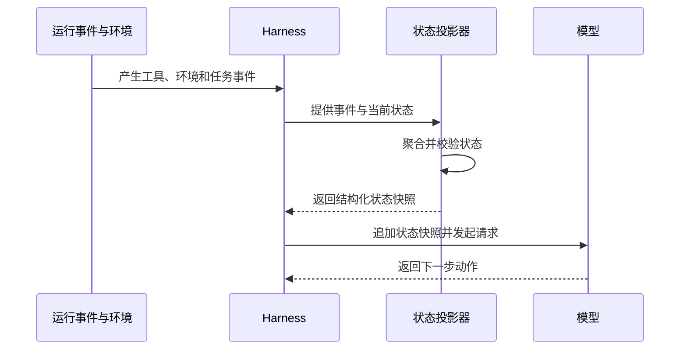
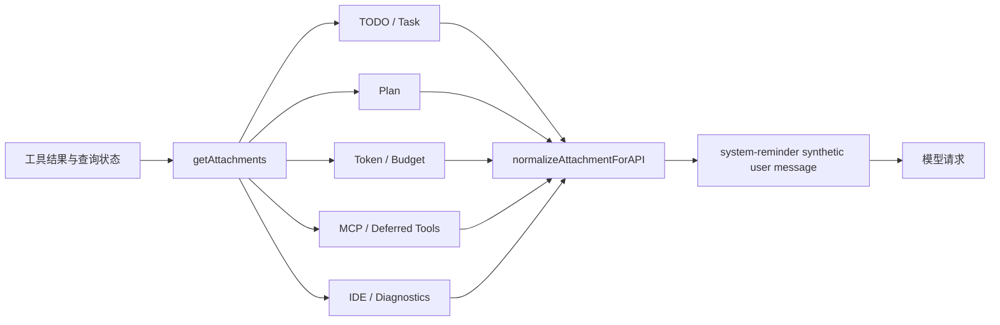
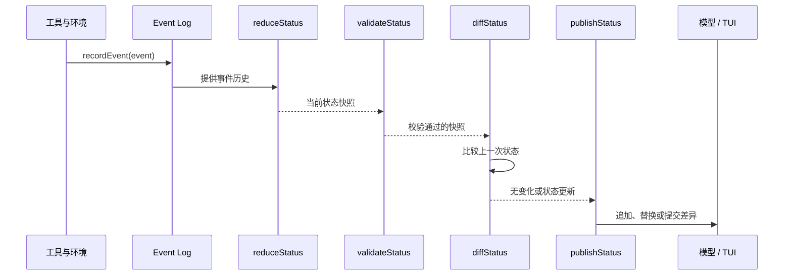

# Agent 上下文状态栏

## 1. 概述

Agent 最适合处理步骤数量无法预先确定的任务。例如，修复一个线上问题通常要经历：理解问题、搜索代码、读取配置、修改实现、运行测试、分析失败、继续修改和提交变更。每一步的结果都会影响下一步，任务可能持续几十轮模型调用和工具执行。

这类任务称为 Long Horizon Task，即长程任务。长程任务的难点不在某一次模型调用，而在整个执行过程会持续变化：

- 模型调用可能因为网络、服务限流或进程异常中断；
- 工具执行可能等待用户授权、后台任务或外部系统返回；
- 工作目录、Git 分支、权限、预算和可用工具可能发生变化；
- 上下文压缩会删除部分历史消息；
- Agent 重启后需要从持久化状态恢复任务；
- 模型可能重复执行已经失败的动作，或者过早宣布任务完成。

这里以“修复支付回调签名校验”的工程场景为例，Agent 可能已经完成以下动作：

1. 读取支付回调实现和对应测试；
2. 修改签名校验逻辑；
3. 运行测试，41 个通过、1 个失败；
4. 切换到 `services/payment` 目录；
5. 连续两次搜索没有发现新的实现；
6. 剩余 8 次工具调用预算。

这些状态通常掌握在 Harness 内部。模型每次调用 API 时，只能看到 Harness 重新组装的请求。如果请求只包含最近的工具结果，模型可能继续搜索已经搜索过的关键词，忘记测试失败，或者把相对路径解释成仓库根目录下的路径。

因此，Harness 需要把内部状态转换成模型能够直接读取的上下文内容：



这条状态快照就是 Agent 上下文状态栏。它不保存完整执行历史，也不替代工具结果，作用是把下一步决策需要的关键状态重新放到模型面前。

## 2. Agent 上下文状态表示

### 2.1 上下文有状态性

Harness 框架有自己的状态，模型 API 调用本身通常是无状态的。Harness 知道任务已经运行到哪一步、工具调用了多少次、当前目录是什么、哪些测试失败；模型只有在这些信息被重新写入请求后才能使用它们。

这种状态断层会带来五类问题。

**决策盲区：** Harness 已经知道某个工具达到调用上限，模型却看不到计数，继续执行第 4 次调用。Harness 已经切换工作目录，模型仍按照旧目录拼接路径。真实状态与模型观察不一致，模型的决策自然会偏离。

**目标漂移：** 长任务中会累积大量局部结果。模型最近看到的是一个测试错误，用户最初要求的完整目标却被埋在较早消息中。没有当前目标和阶段摘要，模型容易把局部修复当成整个任务。

**从轨迹猜状态：** 工具结果通常描述“这次发生了什么”，不一定记录“到目前为止总共发生了什么”。模型需要从多轮输出中推断调用次数、失败次数和剩余工作，这种推断会受到截断、重复输出和工具格式差异影响。

**自我感知不足：** 模型不知道自己已经连续失败几次、已经花费多少轮、是否接近预算上限。没有这些信息，它无法判断应该继续重试、改变策略、请求用户确认还是停止。

**任务恢复困难：** 进程重启或上下文压缩后，模型可能只收到摘要，Harness 却拥有更完整的持久化状态。如果没有标准化状态表示，恢复流程很难决定哪些状态必须重新注入。

上下文状态栏负责弥合这条断层：把 Harness 私有、权威、实时的状态，转换成模型能够读取的结构化文本或结构化消息。

### 2.2 状态栏原理

模型可以从上下文中检索已经存在的内容，但“已经调用了几次”“还剩多少预算”“当前阶段是否完成”这类结论需要对多条事件进行归纳。随着轨迹增长，模型每次重新统计都会消耗额外推理 token，也会受到历史截断和注意力分散影响。

因此，需要引入一个类似状态栏的组件结构，把归纳工作从模型侧移动到程序侧：

```text
原始事件：
- grep 调用 1：找到 2 个文件
- grep 调用 2：没有新增结果
- grep 调用 3：没有新增结果

程序状态：
- grep 总调用：3
- 连续无新增结果：2
- 建议动作：停止扩大搜索，读取已找到文件
```

模型收到的是程序已经计算好的结论，不需要在每轮重新数事件。状态栏因此具有三个作用：

1. **提供运行时事实**：让模型看到工作目录、权限、预算和工具状态；
2. **提供任务进度**：让模型知道当前阶段、完成项和下一步目标；
3. **提供控制信号**：在重复失败、预算不足或验证失败时提醒模型改变策略。

状态栏只保存当前决策所需的投影。原始事件、工具结果和测试产物继续保留，状态错误时可以回溯和修正。

### 2.3 状态栏组成结构

一个实用的状态栏可以分为七类信息：

| 类别 | 字段示例 | 数据来源 | 影响的决策 |
| --- | --- | --- | --- |
| 任务状态 | 目标、阶段、TODO、下一步 | 任务事件、计划工具 | 继续执行还是进入验证 |
| 环境状态 | `cwd`、平台、Shell、当前时间 | 会话环境、终端 | 路径解析和命令执行 |
| 仓库状态 | Git 分支、变更文件、最近提交 | Git 查询 | 修改范围和提交策略 |
| 工具状态 | 调用次数、失败次数、重复结果 | 工具调度器 | 重试、换工具或停止 |
| 验证状态 | 测试、Linter、类型检查 | 验证工具 | 修复错误还是继续推进 |
| 资源状态 | 剩余 token、工具次数、费用 | usage 和预算 | 压缩、降级或终止 |
| 权限状态 | 沙盒、审批、网络和可写目录 | 权限系统 | 是否允许执行动作 |

状态栏只保留当前决策需要的字段。完整测试日志、Git diff、命令输出和网页正文继续保存在工具结果或外部产物中，并在状态栏中保留引用：

```json
{
  "stage": "testing",
  "next_action": "修复 test_invalid_signature",
  "verification": {
    "passed": 41,
    "failed": 1,
    "artifact": "artifacts/tests/run-018.log"
  },
  "git": {
    "branch": "fix/signature",
    "changed_files": 2,
    "diff_artifact": "artifacts/git/diff-018.patch"
  }
}
```

### 2.4 状态栏在上下文的位置

稳定规则、工具定义和固定示例位于请求前部，状态栏属于动态上下文，通常放在当前消息轨迹末尾：

```text
system：Agent 身份、权限、固定流程
user：用户目标
assistant/tool：历史动作和工具结果
user：本轮用户补充
user：Harness 生成的 Agent 状态栏
```

这里的最后一条 `user` 只是 API 协议中的消息角色，并不代表状态来自终端用户。Harness 可以使用应用自定义标签标记状态来源：

```xml
<agent-status source="runtime" generated-at="2026-10-14T10:30:00+08:00">
  <task stage="testing">
    <next-action>修复 test_invalid_signature</next-action>
  </task>
  <environment>
    <cwd>/repo/services/payment</cwd>
  </environment>
</agent-status>
```

`<agent-status>` 属于应用层文本结构。OpenAI、Anthropic 和自托管模型的 API 仍通过 `role`、`content` 及供应商消息格式表达上下文。

状态栏放在末尾有两个工程原因：

- 它靠近模型即将生成的新 token，当前阶段和下一步信息更容易被使用；
- 追加尾部不需要修改前面的 system prompt 和工具定义，有利于缓存复用。

### 2.5 状态栏缓存与更新

状态栏更新同时影响三个对象：模型可见消息、Prompt Cache 前缀、持久化状态。完整设计需要同时规定以下内容：

- 新状态在消息列表中的位置；
- 旧状态是否继续参与模型上下文；
- 仍可复用的缓存 token 范围；
- 进程重启后的当前状态恢复方式；
- 压缩后的重复状态与陈旧状态处理方式。

先定义一个状态变化：

```text
第 1 次：cwd=/repo，测试失败=0，工具剩余=10
第 2 次：cwd=/repo/services/payment，测试失败=1，工具剩余=8
```

假设固定前缀为 `P`，第 1 次状态为 `S1`，两次调用之间新增的工具轨迹为 `R`，第 2 次状态为 `S2`。三种策略的消息序列如下：

```text
持久追加：P + S1 + R + S2
当前快照替换：P + R + S2
基线加增量：P + S1 + R + Δ(S1 → S2)
```

其中 `P` 通常包含 system prompt、固定工具定义和固定示例；状态栏放在尾部，避免动态字段改变 `P`。

#### 持久追加

持久追加把每次状态快照作为一条新消息写入轨迹，旧快照仍然保留：

```json
[
  {"role": "system", "content": "固定规则和工具规范"},
  {"role": "user", "content": "开始修复支付回调"},
  {"role": "user", "content": "<agent-status>cwd=/repo; tests=0</agent-status>"},
  {"role": "tool", "content": "pytest: 1 failed"},
  {"role": "user", "content": "<agent-status>cwd=/repo/services/payment; tests=1</agent-status>"}
]
```

**缓存行为：** 追加不会修改已有 token。只要服务商仍保留对应缓存、请求前缀没有被压缩或截断，前面的 `P + S1 + R` 可以继续作为下一次请求的前缀。新状态从追加位置开始计算。

**上下文行为：** 模型可以查看状态变化过程，例如发现工作目录在什么时候切换、测试失败是在什么动作之后出现。对于调试、审计和需要理解状态演进的任务，这些历史有价值。

**成本：** 状态 token 按更新次数线性累积。若每条状态为 `S` token，更新 `N` 次，仅状态本身就会占用约 `N × S` token。模型还要从多个快照中识别最后一条有效状态，状态字段越多、更新越频繁，陈旧信息造成的歧义越明显。

**恢复要求：** 需要把每条状态消息和生成时的事件序号一起持久化。恢复时不能只保留最后一条状态，否则消息中的历史动作和状态变化可能无法对应。压缩后可以把旧状态合并成一条摘要，但必须明确摘要中的当前值覆盖了哪些旧状态。

**适用场景：**

- 状态消息很短，例如几十个 token；
- 状态更新间隔较长；
- 任务轨迹长度受控；
- 需要审计状态如何变化；
- 状态变化本身会帮助模型理解任务过程。

**不适用场景：** 高频 token 统计、每秒更新的后台进度、大量字段的环境快照和很长的自动化任务，都会让陈旧状态快速堆积。

#### 当前快照替换

当前快照替换把完整状态保存在事件日志中，但模型可见消息只保留最新版本：

```text
持久化日志：
status-001: cwd=/repo; tests=0
status-002: cwd=/repo/services/payment; tests=1

当前模型视图：
P + R + status-002
```

**缓存行为：** 如果 `status-001` 位于轨迹尾部，替换它会使替换位置之后的缓存失效。`P` 仍然可以复用，重算范围通常只覆盖上一次状态之后的短尾部和新状态。状态消息越靠后、越短，替换成本越小。

**上下文行为：** 模型只看到最新状态，不需要判断哪一条状态已经过时。对于 `cwd`、剩余预算、当前阶段、当前测试结果这类“当前值优先”的字段，替换能够降低歧义。

**实现要求：** 需要同时维护两个序列：

```text
Event Log：不可变事件，保留所有状态版本和证据
Model Surface：当前消息视图，只保留最新状态
```

如果只在 `messages` 数组中原地删除旧状态，进程崩溃后无法恢复，也无法解释当前状态来自哪个事件。DeepSeek Harness 的 Session log 与 Surface 就是这类设计的完整实现。

**删除语义：** 状态被清空时不能简单地删除消息后沉默。模型可能仍然依据上一轮状态行动。需要追加一个清除标记：

```text
Current runtime context: none.
Earlier runtime-context snapshots no longer apply.
```

**适用场景：**

- 状态快照较大；
- 更新频率高；
- 状态字段以当前值为主；
- 任务轨迹较长；
- 系统有独立的事件日志和当前消息视图。

**代价：** 每次替换都会让替换点后的缓存重新计算。替换点如果被放在上下文中部，后续大量历史都会失去缓存；因此状态消息必须靠近尾部，不能把它插入固定规则和工具定义之间。

#### 基线加增量

基线加增量先发送一份完整状态，后续只发送变化字段：

```text
初始 baseline：
<environment cwd="/repo" />
<verification passed="0" failed="0" />
<budget tool-calls-left="10" />

后续 delta：
<environment cwd="/repo/services/payment" />
<verification failed="1" />
<budget tool-calls-left="8" />
```

这种方案必须定义字段覆盖规则。下面两种 delta 的含义不同：

```xml
<!-- 更新字段 -->
<verification failed="1" />

<!-- 删除字段或表示空值 -->
<verification failed="0" error="" />
```

如果没有明确的删除和覆盖语义，模型会把旧值和新值同时保留。Codex 的 WorldState section、OpenCode 的 Instruction Source 都在解决这个问题：前者以 section snapshot 生成差异，后者使用 initial/changed/removed 三种渲染方式。

**缓存行为：** 增量消息只追加，稳定前缀保持不动。与持久追加相比，新增状态通常更短；与当前快照替换相比，不需要修改旧消息。缓存表现较好，但模型需要理解“当前 baseline + 后续 delta”的合并规则。

**恢复行为：** 必须持久化 baseline、当前值和已处理的 delta 序号。压缩后要把当前值提升为新 baseline，否则新窗口需要重放很长的 delta 序列。OpenCode 的 epoch 就是这个操作：`current_values` 复制到新的 `initial_values`，旧增量不再进入新窗口。

**适用场景：**

- 状态字段很多，变化频率不同；
- 权限、工具和环境需要独立更新；
- 需要区分字段更新和字段删除；
- 系统有持久化 checkpoint；
- 能够接受较复杂的状态协议。

**代价：** 状态协议复杂，字段新增、删除、重命名和版本升级都需要兼容；调试时也不能只看最后一条消息，必须重放 baseline 和 delta 才能还原模型实际看到的状态。

#### 三种策略的成本判断

设每条完整状态大小为 `S`，两次更新之间新增轨迹为 `R`，更新次数为 `N`，缓存读取价格相对普通输入价格为 `α`：

```text
持久追加：状态本身约占 N × S
当前替换：每轮重算状态之后的尾部，约受 R 影响
基线增量：状态变化字段的大小约为 Δ，长期成本约受 N × Δ 影响
```

实际选择不能只看 token 数量，还应观察：

- 状态消息的平均大小和 p95 大小；
- 状态每轮更新次数；
- 状态更新后到下一次压缩的距离；
- Prompt Cache 命中率和缓存读取价格；
- 模型是否容易误读陈旧状态；
- 进程恢复时重建 baseline 的耗时。

一个简单的实验表可以帮助选择：

| 指标 | 持久追加 | 当前替换 | 基线增量 |
| --- | ---: | ---: | ---: |
| 状态历史完整性 | 高 | 依赖事件日志 | 高 |
| 当前上下文清晰度 | 中 | 高 | 中高 |
| 实现复杂度 | 低 | 中 | 高 |
| 陈旧状态风险 | 高 | 低 | 中 |
| 前缀稳定性 | 高 | 中 | 高 |
| 压缩恢复复杂度 | 中 | 中 | 高 |

推荐默认策略是“事件日志保存完整事实，模型 Surface 保留当前状态，稳定字段使用 baseline，变化字段使用 delta”。这组合了三种策略的主要优点，但需要把 Surface、baseline 和事件日志明确区分。

## 3. 状态栏工程实践

下面四个实现使用同一个状态变化进行比较：工作目录从 `/repo` 切换到 `/repo/services/payment`。分析每个实现的状态来源、状态投影、模型消息、旧状态处理和恢复方式。

### 3.1 Claude Code 状态栏

<iframe src="/diagrams/status-claude-code.html" title="Claude Code 状态栏链路" loading="lazy" style="width:100%;height:auto;aspect-ratio:1000/260;border:0;display:block;margin:24px 0;"></iframe>

#### 状态栏结构

本节分析本地 `claude-code-best` 仓库。它是 Claude Code CLI 的逆向开源实现和扩展，不能直接代表 Anthropic 闭源版本的全部行为。

Claude Code Best 将状态拆成两条路径。

终端状态线位于 `src/components/StatusLine.tsx`、`BuiltinStatusLine.tsx` 和 `src/types/statusLine.ts`，显示模型、上下文使用率、费用、速率限制、缓存命中、工作目录、权限模式和 worktree。

模型状态由 `src/utils/attachments.ts` 生成。附件类型包括：

- TODO 与任务列表；
- Plan mode；
- 日期变化；
- token 与费用预算；
- MCP 指令和延迟工具变化；
- IDE 选择、诊断和异步 Hook 结果。

状态源由多个独立 producer 组成。每个 producer 负责自己的读取、触发和渲染：



这种拆分解决了更新频率不同的问题。日期只在跨日时变化，TODO 根据 assistant turn 节流，token 可以每轮变化，MCP 只在能力变化时更新。它也把故障限制在单个状态 producer 内，一个诊断查询失败不会阻塞 token 或计划状态。

这里的核心数据结构是附件联合类型，最终字符串由它渲染得到。以 token、预算和计划为例，运行时先保存结构化对象：

```typescript
type Attachment =
  | { type: "token_usage"; used: number; total: number; remaining: number }
  | { type: "budget_usd"; used: number; total: number; remaining: number }
  | { type: "plan_mode"; reminderType: "full" | "sparse"; planFilePath: string }
  | { type: "todo_reminder"; content: TodoItem[]; itemCount: number }
```

`getAttachments()` 只负责收集，`normalizeAttachmentForAPI()` 才决定如何变成模型消息。这样可以让 token usage 的功能开关、Plan reminder 的 turn 节流和 MCP 状态变化各自拥有独立生命周期。

#### 状态栏更新

`src/query.ts` 在工具执行结束、下一轮模型调用前收集附件。`src/utils/messages.ts` 使用：

```typescript
export function wrapInSystemReminder(content: string): string {
  return `<system-reminder>\n${content}\n</system-reminder>`
}
```

这个标签只负责内容包装，供应商级 system role 仍由 API 消息结构决定。附件最终通常表示为 synthetic user message，并通过 `isMeta` 和附件类型记录来源。附件规范化阶段还可能将 reminder 合并到相邻 user/tool-result 消息，因此内部 attachment 的位置和最终 API 消息位置不一定相同。

一轮工具调用的实际顺序是：工具返回结果后，`query.ts` 更新工具上下文；`getAttachments()` 并行读取各类状态；`createAttachmentMessage()` 为附件生成 UUID 和时间戳；`normalizeAttachmentForAPI()` 包装成模型消息；下一轮请求才会看到这些状态。调试时应检查最终 API 消息，不能只看内部 transcript。

静态 system prompt 使用动态边界分隔缓存区域。日期变化、晚连接的 MCP 指令和延迟工具变化通过尾部附件进入请求，不重建稳定前缀。

Git 状态采用会话开始快照，包含分支、工作区状态和最近提交，并通过 memoize 缓存。模型修改代码后，这份快照不会自动更新，只能通过 Git 工具重新查询当前状态。这是缓存稳定性和状态新鲜度之间的明确取舍。

因此 Claude Code Best 的状态存在不同的新鲜度等级：token 和工具预算接近当前轮次，Plan 按 turn 节流，日期按天变化，Git 摘要则是会话级快照。状态字段必须同时说明值和刷新方式，否则模型会把启动时的 Git 分支误认为当前分支。

压缩时，能重新计算的附件可以移除；用户确认、工具结果和无法重建的事实必须留在 transcript 或外部产物中。Attachment producer 需要明确自己的保留、清理和重建策略。

压缩后重新收集附件时，应依据当前状态重新计算，不能复用旧字符串。比如当前 Plan 文件已被删除，重新构造的 Plan attachment 就不能继续使用压缩前的文本；用户确认和工具结果必须保留原始事件，不能依赖附件重新生成。

### 3.2 Codex 状态栏

<iframe src="/diagrams/status-codex.html" title="Codex WorldState 链路" loading="lazy" style="width:100%;height:auto;aspect-ratio:1000/260;border:0;display:block;margin:24px 0;"></iframe>

#### 状态栏结构

Codex 将 TUI 状态线和模型状态分开。`status_line_setup.rs` 的模型名、目录、Git 分支、权限、token、费用和任务进度只服务 TUI；模型状态由 `TurnContext`、`StepContext` 和 `WorldState` 共同生成。

- `TurnContext` 保存一个 turn 内稳定的模型、权限、审批、日期、环境和协作配置；
- `StepContext` 冻结当前请求使用的环境、工具路由、AGENTS.md 和 token 预算；
- `WorldState` 把当前状态拆成 environment、permissions、collaboration、tools 等 section。

以工作目录变化为例，模型不会读取 TUI 上的目录字符串。`StepContext` 先确定当前目录，`build_world_state_for_step()` 再用相同快照生成 `<cwd>`、Shell、日期、时区、网络和文件系统策略，工具执行也读取相同的 StepContext。

Codex 的关键约束是模型观察和工具执行共享同一个 StepContext。否则会出现：TUI 显示 `/repo/services/payment`，模型仍看到 `/repo`，工具却已经在新目录运行，模型生成的相对路径就可能指向错误位置。

#### 状态栏更新

Codex 为每个 WorldState section 保存 snapshot。首次模型请求注入完整状态，后续请求按 section 计算差异。

权限策略是一个典型例子：

```text
旧状态：
policy = workspace-write
approved_prefixes = []

新状态：
policy = workspace-write
approved_prefixes = ["npm test"]

本轮注入：
Approved command prefix saved: npm test
```

策略没有变化，模型不需要再次读取完整权限说明。每个 section 的稳定 ID 和 snapshot 都会参与 checkpoint。系统先把差异写入模型历史，再推进 baseline，避免恢复时 baseline 指向模型没有见过的内容。

WorldStateSnapshot 保存每个 section 的比较值，不保存整份 prompt。section 没变化时不生成消息，section 改变时生成替换或增量片段，section 删除时生成失效片段。稳定 section ID 因此属于持久化格式，修改它会被系统理解为旧 section 删除、新 section 新增。

上下文压缩创建新的窗口，Core 重新生成完整初始状态并保存新的 `TurnContextItem` 和 WorldState snapshot。旧窗口的差异不需要逐条复制。

压缩后的流程是：保留可继承事件、创建新窗口、用当前 StepContext 生成完整 WorldState、写入 developer/user fragments、保存新的 TurnContextItem 和 baseline。Codex 不需要把旧窗口中的所有状态差异重新播放一遍。

TUI 的 Git 分支和 `Tasks n/m` 不会自动进入 WorldState。Codex 的设计将“终端显示字段”和“模型决策字段”当成两个独立消费者。

这意味着终端显示字段不能直接作为模型事实。模型需要当前分支时，仍需通过 WorldState section、工具结果或专门上下文提供器注入。

### 3.3 OpenCode 状态栏

<iframe src="/diagrams/status-opencode.html" title="OpenCode Instruction State 链路" loading="lazy" style="width:100%;height:auto;aspect-ratio:1000/260;border:0;display:block;margin:24px 0;"></iframe>

#### 状态栏结构

OpenCode 使用 Instruction Source 统一管理日期、环境、项目指令、Skill、MCP 和会话上下文。每个 source 都有稳定 key、读取函数和 initial/changed/removed 渲染规则。

`core/environment` 的状态源会读取：

```text
Working directory
Workspace root folder
Is directory a git repo
Platform
```

这些字段和日期一起组成 instruction baseline。内容按照复用程度排列，稳定内容放前面，容易变化的环境信息放后面。

Instruction Source 可以抽象成一个可重放的读取器：

```typescript
type InstructionSource<T> = {
  key: string
  read(): T
  render: {
    initial(value: T): string
    changed(previous: T, current: T): string
    removed?(previous: T): string
  }
}
```

`read()` 不负责写消息，`render` 不负责判断变化。运行时先把值规范化并计算 hash，Instruction State 再决定是否创建更新事件。这样，状态读取、状态比较、文本渲染和持久化各自有明确职责。

#### 状态栏更新

运行时对 source 的值做 canonical JSON hash。hash 不变，不生成新消息；hash 变化，写入 durable instruction event：

```text
旧状态：Working directory: /repo
新状态：Working directory: /repo/services/payment

The environment you are running in is now:
<env>
  Working directory: /repo/services/payment
  Workspace root folder: /repo
  Is directory a git repo: yes
  Platform: darwin
</env>
```

删除状态时生成 “no longer applies” 说明，避免模型同时保留旧值和新值。Plan reminder 使用 synthetic user message 靠近当前用户输入；compaction 或 revert 删除后，下一次请求重新补入。

更新文本会被冻结写入 durable instruction event，回放旧事件时不重新读取当时的工作目录或插件环境，否则历史含义会随着当前环境改变。hash 存在于 state，原始规范化值存在于 blob，当前模型请求从 current values 生成 baseline。

Instruction state 保存 `epoch_start`、`initial_values`、`current_values` 和处理序号。压缩后将 current values 复制为新窗口 baseline，旧增量不再逐条重放。项目指令消息如果被压缩移出活动历史，也会依据持久化路径信息重新发现。

epoch 的作用是把不断增长的 instruction delta 切成上下文窗口。旧 epoch 用于审计，新 epoch 只需要完整当前 baseline 和之后的新变化；没有 epoch，压缩后的请求就必须重放整个会话的状态更新历史。

OpenCode 的 TUI footer 显示 token、费用、目录和 Git 分支，但这些字段不会自动写入 instruction state。Core `<env>` 说明是否为 Git 仓库，不自动提供当前分支；Shell environment 只服务命令执行。

### 3.4 DeepSeek Harness 状态栏

<iframe src="/diagrams/status-deepseek-harness.html" title="DeepSeek Harness 状态链路" loading="lazy" style="width:100%;height:auto;aspect-ratio:1000/260;border:0;display:block;margin:24px 0;"></iframe>

#### 状态栏结构

DeepSeek Harness 将模型输入拆成两层：

```text
Session log：保存完整事件，负责恢复和审计
Surface：保存当前参与模型请求的事件序号
```

Session log 记录 `system/message`、`developer/message`、`user/message`、`assistant/message`、`tool/result`，以及 TODO、工作目录、计划和任务调度事件。

状态生产器包括：

- `working-directory`：工作目录变化；
- `time-context`：时间和经过时间；
- `tmux-context`：tmux session、window、pane；
- `agent-instructions`：AGENTS.md；
- `tool-todo`：完整 Todo 快照；
- `repeat-tool-reminder`：重复工具提醒；
- `jobs`：后台任务和进度；
- `schedule`：定时提醒。

每个 producer 只产生自己的事件或快照，不直接修改其他 producer 的状态。

这些 producer 可以分成两类：`working-directory`、Todo、schedule 和 jobs 产生需要持久化的事实；time-context、tmux-context 和 repeat-tool-reminder 更接近当前观察，可以在 pre-step 中重新采集。两类状态都可能进入模型，但恢复方式不同：前者依赖 Session log，后者可以依赖当前环境重建。

#### 状态栏更新

`RuntimeContextProjection` 维护当前 runtime-context 的 `{seq, text}`。每次 pre-step 重新渲染 provider：

```typescript
project(current, sections) {
  if (this.retained === undefined && current.length === 0) return

  const snapshot = current.length === 0 ? CLEARED : current
  if (this.retained?.text === snapshot) return

  return createUserMessage({
    content: [{ type: "text", text: snapshot }],
    source: { kind: "runtime-context", form: "snapshot", sections },
  })
}
```

文本不变时跳过消息；文本变化时生成新的 user message；所有 provider 清空时写入 cleared marker。

旧快照从 Surface 中替换出去，但原始事件仍保留在 Session log：

```text
Session log：
runtime-context-001: cwd=/repo
runtime-context-002: cwd=/repo/services/payment

当前 Surface：
runtime-context-002
```

Agent loop 在每个 step 进入模型前执行 `agent/pre-step`，先刷新状态，再写入 Session，最后从 Surface 派生不可变请求。模型重试会重新刷新 runtime-context，但不会重复接收原始用户输入。

这个顺序形成了明确的一致性点。状态刷新发生在请求冻结之前，工具和环境变化能够进入本次请求；请求冻结后发生的变化进入下一 step。重试只刷新允许变化的 runtime-context，不重复追加最初的用户消息，避免重试改变任务语义。

Surface replacement 还解决了陈旧状态问题。日志可以同时保留 `cwd=/repo` 和 `cwd=/repo/services/payment` 两个事件，模型视图只保留后者。审计需要完整历史，模型决策只需要当前快照，两者由不同数据结构承担。

## 4. 状态栏最佳实践

### 4.1 状态栏工程教训

四个工程给出了四种不同的状态生命周期：

| 设计 | Claude Code Best | Codex | OpenCode | DeepSeek Harness |
| --- | --- | --- | --- | --- |
| 状态来源 | Attachment producer | WorldState section | Instruction Source | Session event + provider |
| 状态比较 | producer 触发与节流 | section snapshot diff | canonical hash diff | runtime text diff |
| 模型消息 | system-reminder synthetic user | developer/user fragment | changed instruction event | runtime-context user message |
| 旧状态处理 | 按附件类型清理或重建 | baseline 推进 | epoch 重建 | Surface replacement |
| 恢复方式 | 重新收集可重建附件 | checkpoint 重建 | instruction epoch | log + Surface 重建 |

可以归纳出五条工程教训。

**第一，状态必须由事实来源计算：** 工具次数来自调度器，测试结果来自测试进程，Git 分支来自 Git 查询，预算来自 usage 和限制。模型只能消费状态，不能作为状态统计器。

**第二，UI 状态和模型状态必须分别验证：** TUI 显示“Git 分支是 fix/signature”，不代表模型已经收到这个字段；状态栏显示“Context 72%”，也不代表下一次请求仍有 28% 可用空间。

**第三，状态消息需要生命周期：** 每条状态必须有产生、比较、发布、替换、压缩和恢复规则。只定义一段 XML 文本，无法处理长会话和进程恢复。

**第四，状态快照与证据分工不同：** 状态栏写“测试失败 1 个”并保留测试日志路径；状态栏写“修改 2 个文件”并关联 Git diff。摘要出现错误时，通过原始事实回溯和修正。

**第五，缓存策略和状态策略必须一起设计：** 状态小且更新间隔长，可以追加；状态大且频繁变化，应该替换；状态字段很多且更新频率不同，可以采用 section diff 或 instruction source。

### 4.2 最佳实践设计

一套可复用的状态栏可以拆成六个接口：

```text
recordEvent(event)
reduceStatus(events)
validateStatus(snapshot)
diffStatus(previous, current)
renderStatus(snapshot)
publishStatus(update)
```

对应的运行流程是：



推荐的状态事件结构：

```typescript
type AgentEvent =
  | { type: "tool_started"; id: string; name: string; at: number }
  | { type: "tool_finished"; id: string; name: string; ok: boolean; artifact?: string; at: number }
  | { type: "environment_changed"; cwd: string; at: number }
  | { type: "verification_finished"; passed: number; failed: number; artifact: string; at: number }
  | { type: "task_updated"; id: string; status: string; at: number }
```

状态投影只处理事实事件：

```typescript
function reduceStatus(events: AgentEvent[]): StatusSnapshot {
  const snapshot = initialStatus()

  for (const event of events) {
    if (event.type === "environment_changed") snapshot.cwd = event.cwd
    if (event.type === "tool_started") snapshot.tools[event.name].calls += 1
    if (event.type === "tool_finished" && !event.ok) {
      snapshot.tools[event.name].failures += 1
    }
    if (event.type === "verification_finished") {
      snapshot.verification = {
        passed: event.passed,
        failed: event.failed,
        artifact: event.artifact,
      }
    }
  }

  return snapshot
}
```

状态发布时先判断是否变化：

```typescript
async function publishStatus(session: Session, current: StatusSnapshot) {
  const previous = await session.lastStatusSnapshot()
  if (previous && stableHash(previous) === stableHash(current)) return

  const message = {
    role: "user" as const,
    content: renderStatus(current),
    metadata: {
      source: "runtime-status",
      generatedAt: new Date().toISOString(),
    },
  }

  await session.recordStatusSnapshot(current, message)
  await session.appendOrReplaceStatus(message)
}
```

默认采用以下设计：

1. 稳定规则和工具定义放在 system 前缀；
2. 动态状态追加或差异更新到请求尾部；
3. 事件日志保留完整事实；
4. 状态快照保留证据路径和生成时间；
5. 程序计算计数、预算、权限和验证结果；
6. 外部文本经过解析后才能进入状态字段；
7. 压缩后重新计算状态，不复用失效快照；
8. TUI 显示和模型上下文分别测试；
9. 用 token、缓存命中、状态大小和更新频率评估成本；
10. 状态生产器在恢复、重试和进程重启后拥有明确行为。

状态栏的核心是一套从事实到决策上下文的状态投影机制：事件日志保存事实，状态投影生成当前结论，消息发布器选择模型视图，持久层支持恢复，缓存策略控制更新成本。XML 标签和终端底部文字只是两种展示形式。
